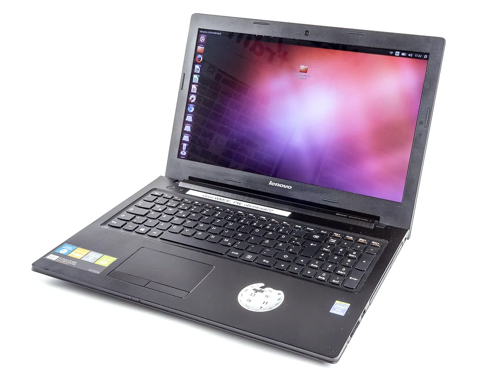
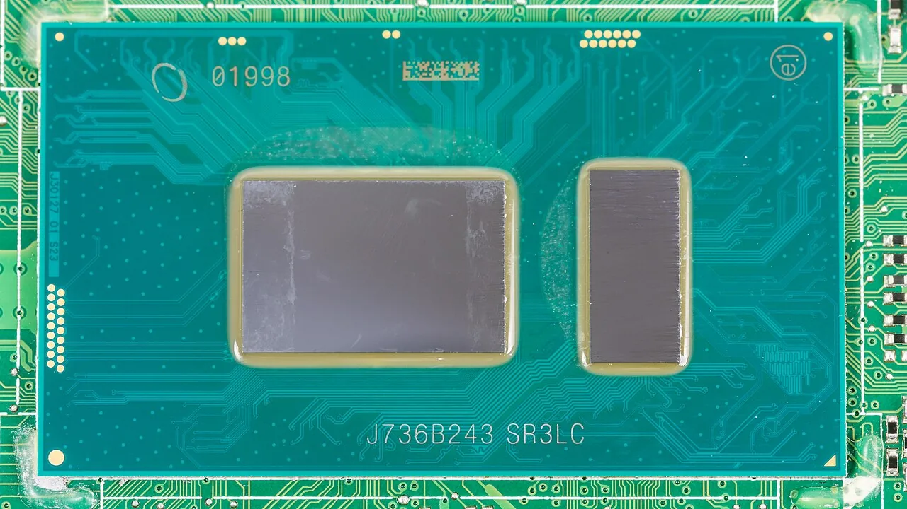
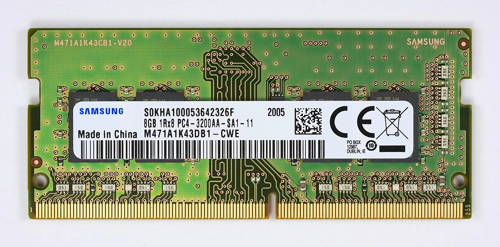
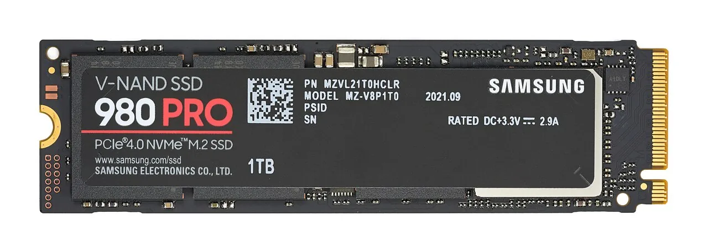
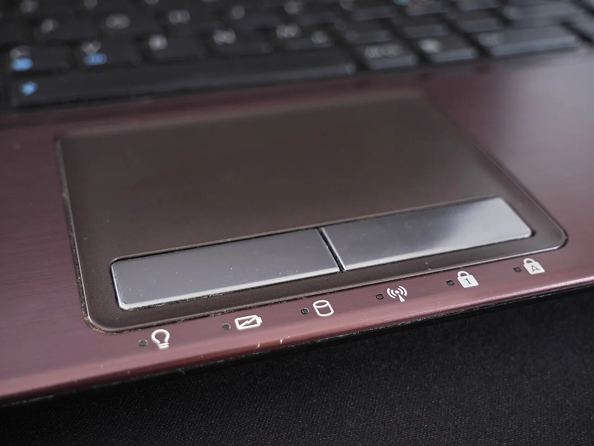
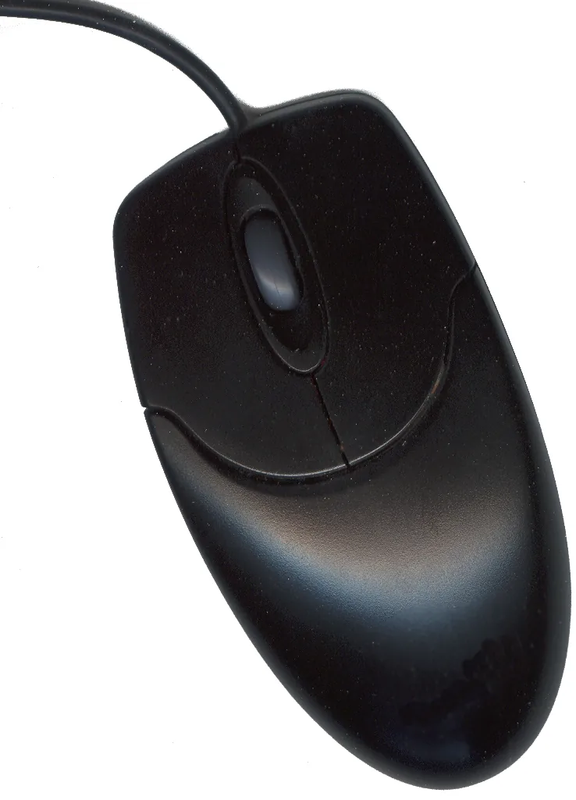
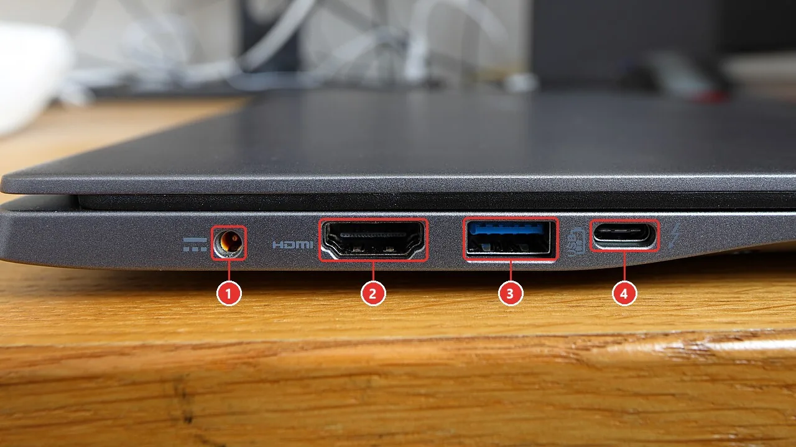
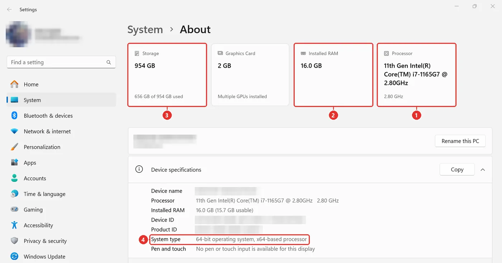
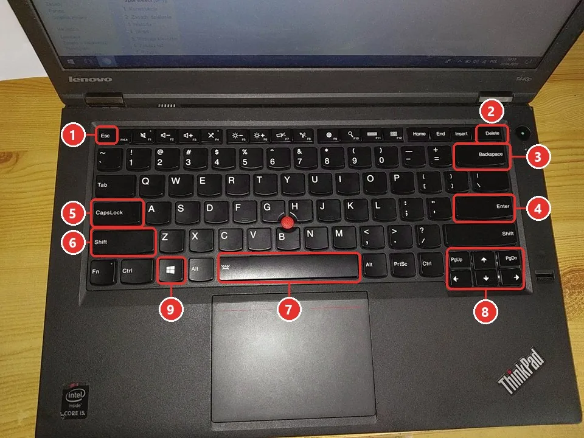

# Student Guide — Computer Application, Stage 1 — Prepared by M. Idris Qadir

## Who is this guide for?

For a student who is just starting with computers. You need nothing before you begin: if you
have never touched a computer, this guide was written for you.

## How to use it

1. **In class,** go step by step with the teacher and do everything with your own hands.
2. **At home,** do it again. This page opens on a phone too.
3. **The red numbers on the pictures,** such as ((1)) and ((2)), are the same numbers you see in the text.
4. **Keys** are written like this: [[Enter]]. When it says [[Shift+A]], hold [[Shift]] and press [[A]] at the same time.
5. **At the end of each lesson** there is a list. Tick ✓ everything you can do.

# Lesson 1 — The computer, and choosing a laptop

> **Today you will learn to** name the parts of a computer, choose a suitable laptop, switch a
> computer on and off properly, and use the mouse and the keyboard.

## 1. What is a computer?

A computer is a machine you do your work with: writing, reading, sending e-mail, watching
pictures and videos, and giving presentations.

There are two common kinds:

- **Desktop computer:** its screen, keyboard and mouse are separate, and it always stays plugged in.
- **Laptop:** all its parts are in one machine; it has a battery and you carry it with you.

In this course we work mostly on laptops.

## 2. Three parts inside

These three parts are inside the laptop and you do not see them, but when you buy a laptop they
matter most.

### Processor (CPU) — the computer's brain

The processor does every job. How fast a computer is depends mostly on this part.

### RAM — the work desk

It is like a desk you put today's work on. The bigger it is, the more programs you can keep open
at once. When you shut the computer down, the RAM is emptied.

### Storage (SSD) — the cupboard for your files

Your files and programs stay here, even while the computer is off. An **SSD** is much faster
than an old **hard disk (HDD)**, so choose an SSD in a new laptop.

> **In short:** processor = brain · RAM = work desk · SSD = cupboard

## 3. Parts outside

- **Screen:** what the computer shows you.
- **Keyboard:** for typing. We look at it closely in part 7.
- **Touchpad:** the laptop's built-in mouse. Move your finger on it and the mouse pointer (cursor) moves on the screen.
- **Mouse:** does the same job as the touchpad, but many people find it easier.

{small}

### Ports — where other devices plug in

| Number | Port | What it is for |
|---|---|---|
| ((1)) | Charging | For the charger. Some laptops charge through USB-C instead |
| ((2)) | HDMI | For a big screen or a projector |
| ((3)) | USB | Flash drives, a mouse, a keyboard and printers |
| ((4)) | USB-C | The new small port: a flash drive, charging or a screen |

> **Practice:** on the laptop in front of you, find these and point at them.

- [ ] The screen, the keyboard and the touchpad
- [ ] The power button
- [ ] The charging port
- [ ] A USB port
- [ ] An HDMI port, if there is one

## 4. Choosing a laptop for Windows 11 and Office 2024

If you have no laptop yet, or want to change yours, take this table with you to the shop.

| Part | Minimum (Microsoft) | Advice for a student |
|---|---|---|
| Processor | Intel 8th generation or newer, or AMD Ryzen 2000 or newer | Core i5 or Ryzen 5 |
| RAM | 4 GB | 8 GB, better 16 GB |
| Storage | 64 GB | An SSD of 256 GB or more |
| Security | TPM 2.0 and Secure Boot | The same |

Office 2024 needs about 4 GB of RAM and 4 GB of free space.

### How do you find the processor's generation?

In the name of an Intel processor, the number after i3, i5 or i7 shows the generation:

- If the number starts with **1**, its **first two** digits are the generation: 1135 → 11th generation
- Otherwise its **first** digit is the generation: 8250 → 8th generation

| Processor name | Generation | Windows 11 |
|---|---|---|
| i5-7200U | 7 | ✗ will not run it |
| i5-8250U | 8 | ✓ |
| i5-10210U | 10 | ✓ |
| i5-1135G7 | 11 | ✓ |
| Core Ultra 5 | Intel's new name | ✓ |

> ### Careful
> An old second-hand laptop made before 2018 often cannot run Windows 11, however cheap it is.

### What to do in the shop

1. Ask them to open **Settings → System → About**.
2. Check these three: the processor ((1)), the RAM ((2)) and the storage ((3)).
3. If you are not sure, use the **PC Health Check** app. It tells you whether that laptop can run Windows 11.

**Example, the laptop above:** processor i7-1165G7 → 11th generation ✓ · RAM 16 GB ✓ · storage 954 GB ✓

## 5. Switching on and off

### Switching on

1. If the battery is low, plug in the charger.
2. Press the power button once and let go.
3. Wait for the sign-in screen, then type your PIN or password and press [[Enter]].

### Shutting down properly

1. Click the **Start** button, on the bar at the bottom of the screen.
2. Click **Power**.
3. Choose **Shut down** and wait until the screen goes completely dark.

| Choice | What it does | When |
|---|---|---|
| **Sleep** | The computer sleeps; your work stays open | A short break |
| **Shut down** | The computer switches off completely | The end of the day |
| **Restart** | It switches off and back on by itself | When the computer is slow or has a problem |

> ### Never
> Do not hold the power button down for several seconds to switch off — unless the computer has frozen
> completely and nothing works. Anything open and not saved is lost.

## 6. The mouse and the touchpad

The mouse pointer (the cursor) is a small arrow on the screen. Move the mouse, or your finger on
the touchpad, and the cursor moves with it.

| Action | With a mouse | With a touchpad | What it does |
|---|---|---|---|
| **Click** | The left button once | Tap once with one finger | Selects something |
| **Double-click** | The left button twice, quickly | Tap twice, quickly | Opens a file or a program |
| **Right-click** | The right button once | Tap with two fingers together | Opens a menu |
| **Drag** | Hold the left button and move | Tap twice and keep your finger down the second time, then move | Moves something |
| **Scroll** | Turn the wheel in the middle | Move two fingers up or down | Moves the page down and up |

Now try it here. Each time you do one, a green ✓ appears.

<!-- practice:mouse -->

> **If the cursor does not move:** on most laptops one of the keys [[F1]] to [[F12]] has a picture
> of a touchpad on it. That key switches the touchpad off and on. If your mouse is wireless, check
> its battery.

## 7. The keyboard

| Number | Key | What it does |
|---|---|---|
| ((1)) | [[Esc]] | Closes a menu, or cancels |
| ((2)) | [[Delete]] | Deletes the letter after the cursor, or the selected file |
| ((3)) | [[Backspace]] | Deletes the letter before the cursor |
| ((4)) | [[Enter]] | A new line, or "OK" |
| ((5)) | [[Caps Lock]] | Makes every letter a capital; press it again to go back |
| ((6)) | [[Shift]] | Hold it for a capital letter (A), or for the sign at the top of the key (!) |
| ((7)) | [[Space]] | The space between two words |
| ((8)) | [[←]] [[→]] [[↑]] [[↓]] | Move the typing cursor |
| ((9)) | [[Win]] | Opens the Start menu |

Now try it here:

<!-- practice:keys -->

> You learn to type **Kurdish** in lesson 4, when we add Kurdish to the keyboard.

## Lesson 1 task

Type your name in English in the keyboard practice above. Make the first letter of your name a
capital, and press [[Enter]] at the end.

## Check yourself

- [ ] I can tell the processor, the RAM and the SSD apart
- [ ] I know whether a laptop can run Windows 11
- [ ] I switch a laptop on and off properly
- [ ] I can click, double-click, right-click and drag
- [ ] I can type my name in English with a capital letter

# Appendix — Where the pictures come from

The photos of the computer's parts come from Wikimedia Commons. They are free to use, as long as
the photographer and the licence are named. The red numbers on the photos of the ports and the
keyboard were added by us.

- **Laptop:** [Lenovo G500s laptop-2903.jpg](https://commons.wikimedia.org/wiki/File:Lenovo_G500s_laptop-2903.jpg) — Raimond Spekking — [CC BY-SA 4.0](https://creativecommons.org/licenses/by-sa/4.0)
- **Processor:** [Mainboard C5V01 LA-E892P - Intel Core i7-8550U-5911.jpg](https://commons.wikimedia.org/wiki/File:Mainboard_C5V01_LA-E892P_-_Intel_Core_i7-8550U-5911.jpg) — Raimond Spekking — [CC BY-SA 4.0](https://creativecommons.org/licenses/by-sa/4.0)
- **RAM:** [DDR 4 RAM SO-DIMM 8GB by Samsung-top front PNr°0838.jpg](https://commons.wikimedia.org/wiki/File:DDR_4_RAM_SO-DIMM_8GB_by_Samsung-top_front_PNr%C2%B00838.jpg) — D-Kuru — [CC BY-SA 4.0](https://creativecommons.org/licenses/by-sa/4.0)
- **SSD:** [Samsung 980 PRO PCIe 4.0 NVMe SSD 1TB-top PNr°0915.jpg](https://commons.wikimedia.org/wiki/File:Samsung_980_PRO_PCIe_4.0_NVMe_SSD_1TB-top_PNr%C2%B00915.jpg) — D-Kuru — [CC BY-SA 4.0](https://creativecommons.org/licenses/by-sa/4.0)
- **Ports:** [Acer Swift 3 rear-left edge.jpg](https://commons.wikimedia.org/wiki/File:Acer_Swift_3_rear-left_edge.jpg) — Bobulous — [CC BY-SA 4.0](https://creativecommons.org/licenses/by-sa/4.0)
- **Keyboard:** [Keyboard Lenovo ThinkPad T440p (QWERTY layout).jpg](https://commons.wikimedia.org/wiki/File:Keyboard_Lenovo_ThinkPad_T440p_%28QWERTY_layout%29.jpg) — Kambiel5 — [CC BY-SA 4.0](https://creativecommons.org/licenses/by-sa/4.0)
- **Touchpad:** [Laptop touchpad 20190320.jpg](https://commons.wikimedia.org/wiki/File:Laptop_touchpad_20190320.jpg) — Santeri Viinamäki — [CC BY-SA 4.0](https://creativecommons.org/licenses/by-sa/4.0)
- **Mouse:** [Generic computer mouse with scrollwheel.jpg](https://commons.wikimedia.org/wiki/File:Generic_computer_mouse_with_scrollwheel.jpg) — Peter Astbury — [CC0](http://creativecommons.org/publicdomain/zero/1.0/deed.en)

The screenshots were taken on a Windows 11 computer, with personal details hidden.