# Student Guide — Computer Application, Stage 1 — Prepared by M. Idris Qadir


## Who is this guide for?

For a student who is just starting with computers. You need nothing before you begin: if you
have never touched a computer, this guide was written for you.

## How to use it

1. **In class,** go step by step with the teacher and do everything with your own hands.
2. **At home,** do it again. This page opens on a phone too.
3. **The red numbers on the pictures,** such as ((1)) and ((2)), are the same numbers you see in the text.
4. **Keys** are written like this: [[Enter]]. When it says [[Shift+A]], keep your finger on the [[Shift]] key and press [[A]] at the same time.
5. **At the end of each lesson** there is a list. Tick ✓ everything you can do.

## Your marks

| Part | Marks | What it is |
|---|---|---|
| Homework | 10 | The task at the end of each lesson |
| Report | 16 | The final project: a report in Word and a presentation in PowerPoint |
| Quizzes | 8 | Two short hands-on quizzes in Google Forms, in English |
| Midterm | 24 | Online and hands-on, on your laptop, on a separate day after lesson 4 |
| Activity | 2 | Your work in class |
| Final | 40 | Online and hands-on, on your laptop, on a separate day after lesson 7 |
| **Total** | **100** | |

**How the papers work:** every paper comes with a file attached to the teacher's e-mail. You download
it, do each task on your laptop, and tick what you see. Every paper is in English.

The mock quiz at the end of lesson 3 does not count: it is there so you try a paper like this once.

# Lesson 1 — The computer, and choosing a laptop

> **Today you will learn to** name the parts of a computer, choose a suitable laptop, switch a
> computer on and off properly, and use the mouse and the keyboard.

## 1. What is a computer?

A computer is a machine you do your work with: writing, reading, sending e-mail, watching
pictures and videos, and giving presentations.

There are two common kinds:

- **Desktop computer:** its screen, keyboard and mouse are separate, and it always stays plugged in.
- **Laptop:** all its parts are in one machine; it has a battery and you carry it with you.

In this course we work mostly on laptops.


## 2. Three parts inside

These three parts are inside the laptop and you do not see them, but when you buy a laptop they
matter most.

### Processor (CPU) — the computer's brain

The processor does every job. How fast a computer is depends mostly on this part.


### RAM — the work desk

It is like a desk you put today's work on. The bigger it is, the more programs you can keep open
at once. When you shut the computer down, the RAM is emptied.


### Storage (SSD) — the cupboard for your files

Your files and programs stay here, even while the computer is off. An **SSD** is much faster
than an old **hard disk (HDD)**, so choose an SSD in a new laptop.


> **In short:** processor = brain · RAM = work desk · SSD = cupboard

## 3. Parts outside

- **Screen:** what the computer shows you.
- **Keyboard:** for typing. We look at it closely in part 7.
- **Touchpad:** the laptop's built-in mouse. Move your finger on it and the mouse pointer (cursor) moves on the screen.
- **Mouse:** does the same job as the touchpad, but many people find it easier.


{small}

### Ports — where other devices plug in


| Number | Port | What it is for |
|---|---|---|
| ((1)) | Charging | For the charger. Some laptops charge through USB-C instead |
| ((2)) | HDMI | For a big screen or a projector |
| ((3)) | USB | Flash drives, a mouse, a keyboard and printers |
| ((4)) | USB-C | The new small port: a flash drive, charging or a screen |

> **Practice:** on the laptop in front of you, find these and point at them.

- [ ] The screen, the keyboard and the touchpad
- [ ] The power button
- [ ] The charging port
- [ ] A USB port
- [ ] An HDMI port, if there is one

## 4. Choosing a laptop for Windows 11 and Office 2024

If you have no laptop yet, or want to change yours, take this table with you to the shop.

| Part | What to buy |
|---|---|
| Laptop | A ThinkPad |
| Processor | Core i5 or Core i7, 8th generation or newer |
| RAM | 8 GB or 16 GB |
| Storage | An SSD of 256 GB or 512 GB |

### How do you find the processor's generation?

In the name of an Intel processor, the number after i3, i5 or i7 shows the generation:

- If the number starts with **1**, its **first two** digits are the generation: 1135 → 11th generation
- Otherwise its **first** digit is the generation: 8250 → 8th generation

| Processor name | Generation | Windows 11 |
|---|---|---|
| i5-7200U | 7 | ✗ will not run it |
| i5-8250U | 8 | ✓ |
| i5-10210U | 10 | ✓ |
| i5-1135G7 | 11 | ✓ |
| Core Ultra 5 | Intel's new name | ✓ |

> ### Careful
> An old second-hand laptop made before 2018 often cannot run Windows 11, however cheap it is.

### What to do in the shop

1. Ask them to open **Settings → System → About**.
2. Check these three: the processor ((1)), the RAM ((2)) and the storage ((3)).
3. If you are not sure, use the **PC Health Check** app. It tells you whether that laptop can run Windows 11.


**Example, the laptop above:** processor i7-1165G7 → 11th generation ✓ · RAM 16 GB ✓ · storage 954 GB ✓

## 5. Switching on and off

### Switching on

1. If the battery is low, plug in the charger.
2. Press the power button once and let go.
3. Wait for the sign-in screen, then type your PIN or password and press [[Enter]].

### Shutting down properly

1. Click the **Start** button, on the bar at the bottom of the screen.
2. Click **Power**.
3. Choose **Shut down** and wait until the screen goes completely dark.

| Choice | What it does | When |
|---|---|---|
| **Sleep** | The computer sleeps; your work stays open | A short break |
| **Shut down** | The computer switches off completely | The end of the day |
| **Restart** | It switches off and back on by itself | When the computer is slow or has a problem |

> ### Never
> Do not hold the power button down for several seconds to switch off — unless the computer has frozen
> completely and nothing works. Anything open and not saved is lost.

## 6. The mouse and the touchpad

The mouse pointer (the cursor) is a small arrow on the screen. Move the mouse, or your finger on
the touchpad, and the cursor moves with it.

| Action | With a mouse | With a touchpad | What it does |
|---|---|---|---|
| **Click** | The left button once | Tap once with one finger | Selects something |
| **Double-click** | The left button twice, quickly | Tap twice, quickly | Opens a file or a program |
| **Right-click** | The right button once | Tap with two fingers together | Opens a menu |
| **Drag** | Keep your finger on the left button and move | Tap twice and keep your finger down the second time, then move | Moves something |
| **Scroll** | Turn the scroll wheel in the middle | Move two fingers up or down | Moves the page down and up |

Now try it here. Each time you do one, a green ✓ appears.

<!-- practice:mouse -->

> **If the cursor does not move:** on most laptops one of the keys [[F1]] to [[F12]] has a picture
> of a touchpad on it. That key switches the touchpad off and on. If your mouse is wireless, check
> its battery.

## 7. The keyboard


| Number | Key | What it does |
|---|---|---|
| ((1)) | [[Esc]] | Closes a menu, or cancels |
| ((2)) | [[Delete]] | Deletes the letter after the cursor, or the selected file |
| ((3)) | [[Backspace]] | Deletes the letter before the cursor |
| ((4)) | [[Enter]] | A new line, or "OK" |
| ((5)) | [[Caps Lock]] | Makes every letter a capital; press it again to go back |
| ((6)) | [[Shift]] | Keep your finger on the [[Shift]] key and press a letter: the letter comes out as a capital (A), or the key types the sign at its top (!) |
| ((7)) | [[Space]] | The space between two words |
| ((8)) | [[←]] [[→]] [[↑]] [[↓]] | Move the typing cursor |
| ((9)) | [[Win]] | Opens the Start menu |

Now try it here:

<!-- practice:keys -->

> You learn to type **Kurdish** in lesson 4, when we add Kurdish to the keyboard.

## Lesson 1 task

Type your name in English in the keyboard practice above. Make the first letter of your name a
capital, and press [[Enter]] at the end.

## Check yourself — lesson 1

- [ ] I can tell the processor, the RAM and the SSD apart
- [ ] I know whether a laptop can run Windows 11
- [ ] I switch a laptop on and off properly
- [ ] I can click, double-click, right-click and drag
- [ ] I can type my name in English with a capital letter

# Lesson 2 — Windows and files

> **Today you will learn to** know the taskbar and the Start menu, handle windows, make folders,
> copy and paste files, and use a flash drive.

## 1. The desktop and the taskbar

When the computer starts, the first thing you see is the **desktop**: the face of the screen. At
the bottom of the screen there is a bar called the **taskbar**.

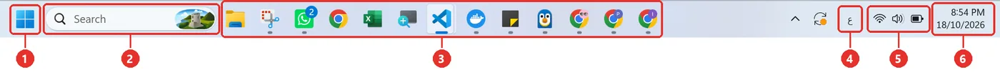

| Number | What it is | What it does |
|---|---|---|
| ((1)) | The Start button | Opens the Start menu |
| ((2)) | Search | Finds a program, a file or a setting by its name |
| ((3)) | Programs | The programs that are open or pinned; one click opens them |
| ((4)) | Keyboard language | Shows the language you are typing in now |
| ((5)) | Wi-Fi, sound and battery | The state of the internet, the sound and the battery |
| ((6)) | Clock and date | Today's time and date |

> In this picture the bar is on the left. On most laptops the Start button and the programs are in
> the middle, but they do the same things.

## 2. The Start menu

Click the Start button, or press the [[Win]] key.

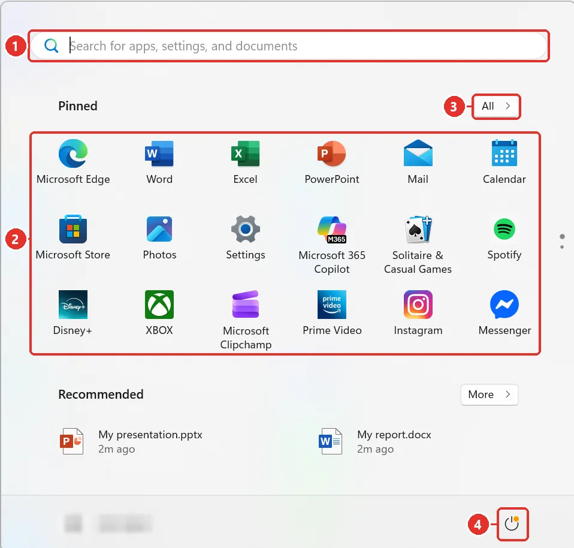

- **Search** ((1)): type the program's name, for example Word, and press [[Enter]].
- **Pinned programs** ((2)): click any of them and it opens.
- **All programs** ((3)): the All button lists every program.
- **Power** ((4)): for Sleep, Shut down and Restart, as you learned in lesson 1.

## 3. Windows

Every program opens in a **window**. In the top right corner of every window there are three
buttons, number ((6)) in the picture of part 4:

| Button | Name | What it does |
|---|---|---|
| — | Minimize | Hides the window in the taskbar; clicking the program there brings it back |
| ☐ | Maximize | The window fills the screen; pressed again, it goes back to its earlier size |
| ✕ | Close | Closes the program |

- **Switching between windows:** click the program in the taskbar, or keep your finger on the
  [[Alt]] key and press [[Tab]].
- **Moving a window:** keep your finger on the left mouse button on the window's top bar, and move.

## 4. File Explorer: files and folders

- **File:** any work you save, such as a letter, a picture or a presentation.
- **Folder:** like a bag you keep your files in, in order. A folder can hold other folders too.

To open File Explorer, click the yellow folder in the taskbar, or press [[Win+E]].

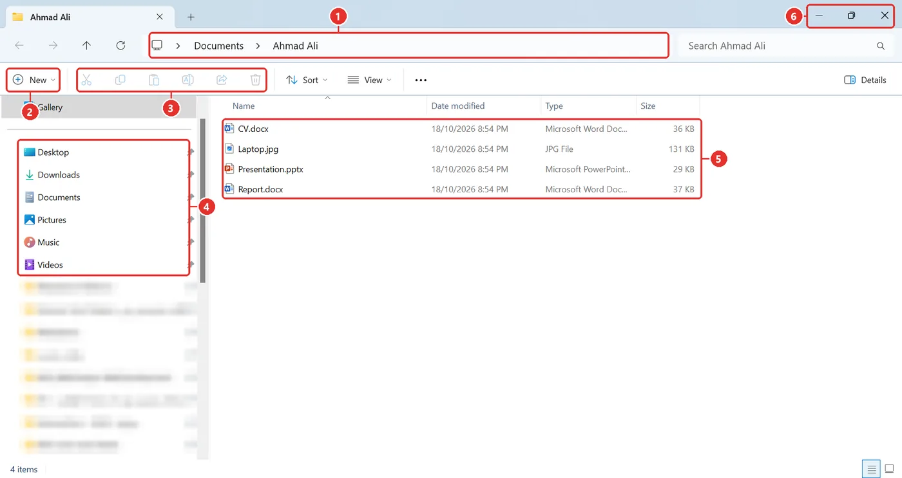

| Number | What it is | What it does |
|---|---|---|
| ((1)) | Where you are | Shows where you are: Documents → Ahmad Ali |
| ((2)) | The New button | Makes a new folder or a new file |
| ((3)) | The action buttons | Cut, copy, paste, rename, share and delete |
| ((4)) | The main folders | Desktop, Downloads, Documents, Pictures, Music and Videos |
| ((5)) | The contents | The files and folders in this place |
| ((6)) | The window buttons | Minimize, maximize and close |

### Making a folder

1. On the left, click **Documents**.
2. Click **New** ((2)) and choose **Folder**. Another way: right-click an empty spot → **New** →
   **Folder**.
3. Type your name and press [[Enter]].

### Renaming, deleting and getting it back

- **Rename:** click the file → press [[F2]] → type the new name → [[Enter]].
- **Delete:** click the file → press [[Delete]]. The file goes to the **Recycle Bin**.
- **Get it back:** on the desktop, double-click the **Recycle Bin** → right-click the file → **Restore**.

## 5. Copy, cut and paste

| Action | With the mouse | With the keyboard | Result |
|---|---|---|---|
| **Copy** | Right-click → Copy | [[Ctrl+C]] | The file stays where it is and a copy is ready |
| **Cut** | Right-click → Cut | [[Ctrl+X]] | The file is ready to be moved |
| **Paste** | Right-click → Paste | [[Ctrl+V]] | The file is put in the new place |

> In Windows 11, Cut, Copy, Paste and Rename appear at the top of the right-click menu as small
> icons, without names. They are the same buttons as ((3)).

To choose several files at once: keep your finger on the [[Ctrl]] key and click the files. To
choose them all: [[Ctrl+A]].

## 6. The flash drive

1. Put the flash drive into a USB port.
2. In File Explorer click **This PC** ((2)). The flash drive appears next to the drives ((1)), with
   a name like **USB Drive**.
3. Copy your file, double-click the flash drive, and paste it.
4. **Removing it safely:** right-click the flash drive → **Eject**, then take it out.

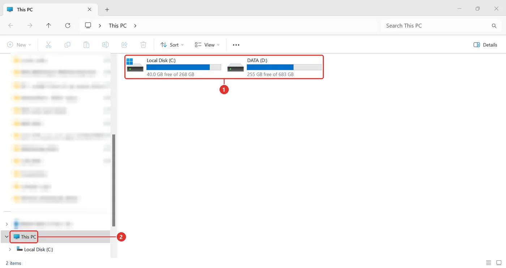

> ### Careful
> Do not pull the flash drive out while it is copying, or the files may be damaged.

## Lesson 2 task

1. In **Documents**, make a folder with your name.
2. Inside it, make two more folders: **Lessons** and **Pictures**.
3. Copy a picture from the computer's Pictures folder and paste it in your new folder.
4. Rename the picture.
5. Copy your whole folder to a flash drive, and remove the flash drive safely.

## Check yourself — lesson 2

- [ ] I can minimize, maximize and close a window
- [ ] I can switch between windows
- [ ] I can make a folder and rename it
- [ ] I can copy and paste a file, with the mouse and with the keyboard
- [ ] I can get a deleted file back from the Recycle Bin
- [ ] I can use a flash drive and remove it safely

# Lesson 3 — The internet and the university Gmail

> **Today you will learn to** connect to Wi-Fi, use the Chrome browser, sign in to your university
> Gmail, know what to do when you forget your password, and send an e-mail with a file.

## 1. Connecting to Wi-Fi

1. In the taskbar, click the Wi-Fi icon, number ((5)) in the taskbar picture of lesson 2.
2. Press the arrow next to Wi-Fi to see the list of networks.
3. Choose the network → **Connect** → type the Wi-Fi password → **Next**.

Another way: [[Win+I]] → **Network & internet** → **Wi-Fi**.

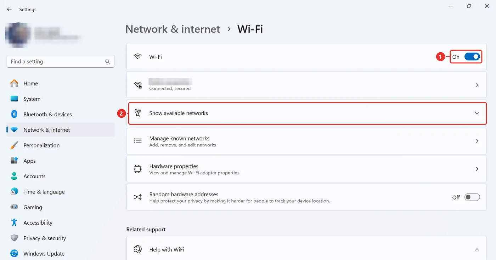

- **Wi-Fi** ((1)): must be **On**.
- **Show available networks** ((2)): lists the networks.

> A Wi-Fi password knows capitals from small letters: A and a are not the same.

## 2. The Chrome browser

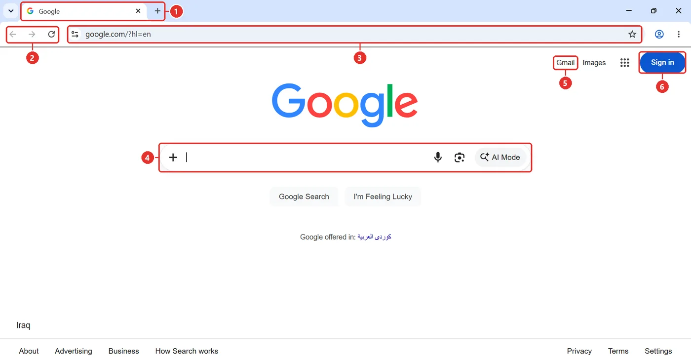

| Number | What it is | What it does |
|---|---|---|
| ((1)) | Tabs and the + button | Each tab is a website; + opens a new tab |
| ((2)) | Back, forward and reload | Go back to the last page, or load the page again |
| ((3)) | The address bar | Type a website's address here, such as gmail.com |
| ((4)) | Google search | Type a question or a word to search for |
| ((5)) | Gmail | Takes you straight to Gmail |
| ((6)) | Sign in | Signs in to a Google account |

- **New tab:** [[Ctrl+T]] — **Close a tab:** [[Ctrl+W]]
- **Downloaded files:** [[Ctrl+J]] lists them. The files go into the **Downloads** folder.

## 3. Signing in to the university Gmail

The institute gives you an e-mail address and a password. Your address ends with **@epu.edu.iq**.

1. In Chrome's address bar type gmail.com and press [[Enter]]. If a page about Gmail appears,
   click **Sign in**.
2. Type your whole e-mail address ((1)) and click **Next** ((3)).
3. Type your password, and **Next** again.
4. If, the first time, it asks for a new password, choose one and type it twice.

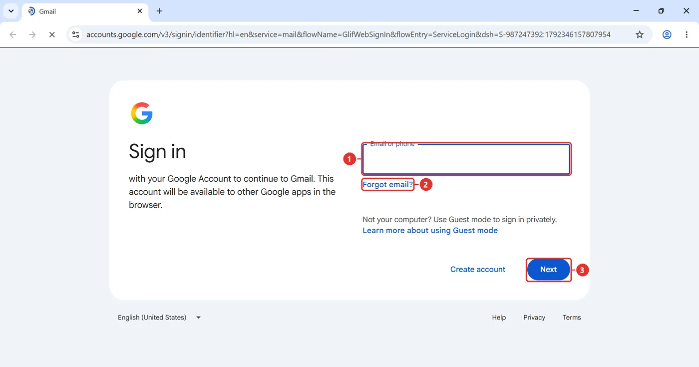

> **A good password:** at least 8 characters, letters and numbers mixed. Tell nobody, and keep it
> written somewhere safe.

## 4. A phone number and a recovery e-mail

If you have added your phone number and a personal e-mail, then the day you forget your password
Google sends them a code. To add them, open this page and find **Recovery phone** and
**Recovery email**:

```
https://myaccount.google.com/security
```

> If those parts are missing or cannot be changed, the university has not allowed it. Then use
> part 5.

## 5. If you forget your password

1. On the password page, click **Forgot password?**.
2. If you added a phone number or a recovery e-mail, a code comes to you. Type it and choose a new
   password.
3. If that does not work, go to the office of the institute that gave you the account.

> Whether you can reset the password yourself depends on the university's settings, not on you.

## 6. Sending an e-mail with an attachment

1. In Gmail, click **Compose**, at the top left.
2. In **To**, type the address of the person receiving it.
3. In **Subject**, type what the message is about.
4. Type the message.
5. Click the 📎 **Attach files** icon → choose the file → **Open**.
6. Wait until the file has finished uploading, then click **Send**.

### Saving a file you received

1. Open the e-mail. The attached files are at the bottom, under the message.
2. Point at the file and click the **Download** arrow. It goes into the **Downloads** folder, and
   [[Ctrl+J]] in Chrome lists it.

### Opening a zip file

A **zip** file holds several files and folders packed into one.

1. In File Explorer, right-click the zip file → **Extract All** → **Extract**.
2. A normal folder with the same name opens. Work in that folder, not inside the zip.

## 7. Signing out on a shared computer

- **Sign out:** click your account picture in the top right corner → **Sign out**.
- **Do not save the password:** if Chrome asks **Save password?**, click **Never**.

## Lesson 3 task

Send an e-mail to the teacher. Its subject should be "Lesson 3 — your name", with a file attached,
for example the picture from the lesson 2 task.

> **Mock quiz:** at the end of this lesson, in Google Forms and not marked: you try a hands-on paper,
> with a file from the teacher's e-mail.

## Check yourself — lesson 3

- [ ] I can connect to Wi-Fi
- [ ] I can type an address in Chrome and open a new tab
- [ ] I can sign in to my university Gmail
- [ ] I know what to do if I forget my password
- [ ] I can send an e-mail with an attachment
- [ ] I can sign out on a shared computer
- [ ] I can save an attachment and open a zip file

# Lesson 4 — Windows settings

> **Today you will learn to** type in Kurdish, set the sound, the brightness and the clock, install
> and remove a program, find your laptop's specifications, and take a screenshot.

To open **Settings**: press [[Win+I]], or Start → Settings.

## 1. Adding Kurdish

1. [[Win+I]] → **Time & language** → **Language & region**.
2. Click **Add a language** ((1)).
3. Type Kurdish and choose **Central Kurdish** → **Next** → **Install**.
4. The new language joins the list of languages ((2)).

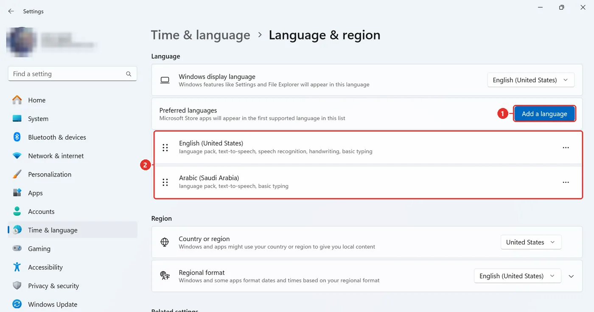

### Switching the keyboard language

- Keep your finger on the [[Win]] key and press [[Space]]: [[Win+Space]]
- or [[Alt+Shift]]
- or click the language in the taskbar, number ((4)) in the taskbar picture of lesson 2.

> Before typing, look at the language in the taskbar. If it says ENG, the letters come out in English.

## 2. Sound and brightness

[[Win+I]] → **System** → **Sound**:

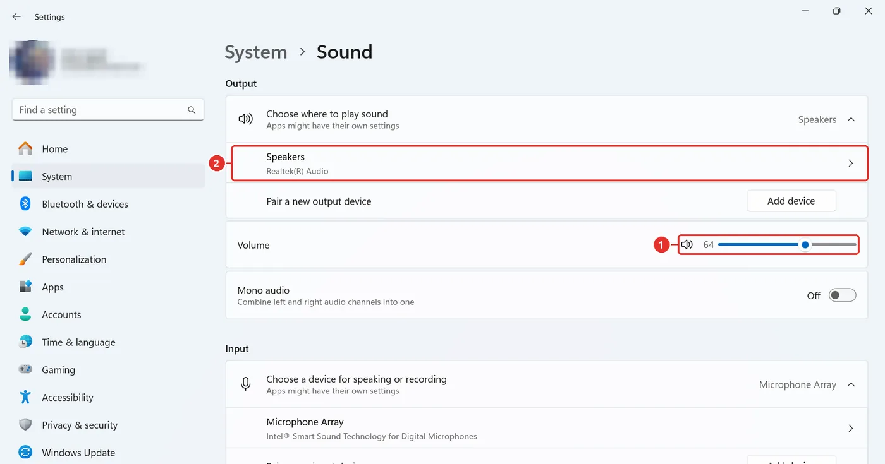

- **Volume** ((1)): how loud.
- **Where the sound goes** ((2)): the laptop's speakers or headphones.

[[Win+I]] → **System** → **Display**:

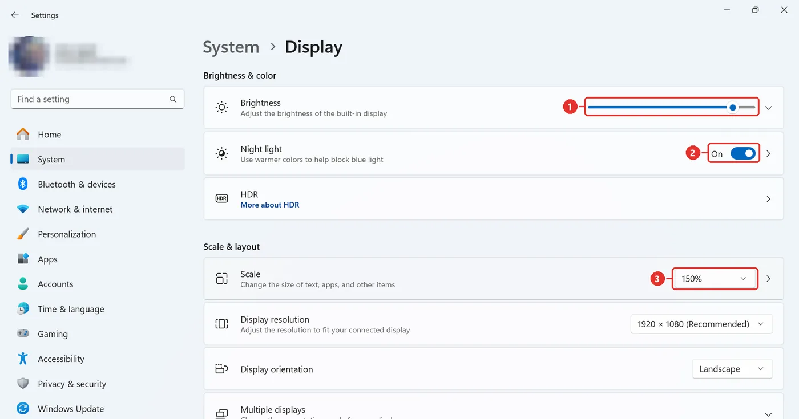

- **Brightness** ((1)): how bright the screen is.
- **Night light** ((2)): makes the screen's colours warmer for the evening.
- **Scale** ((3)): the size of text and icons. If the text is small, make it bigger.

> On most laptops the keys [[F1]] to [[F12]] carry pictures for sound and brightness, and they are quicker.

## 3. Date and time

[[Win+I]] → **Time & language** → **Date & time**:

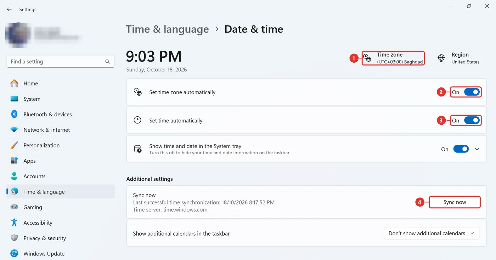

- **Time zone** ((1)): for the Kurdistan Region, (UTC+03:00) Baghdad.
- **Set time zone automatically** ((2)) and **Set time automatically** ((3)): keep both **On**.
- **Sync now** ((4)): if the clock is wrong, press this button.

## 4. Installing and removing a program

- **Install:** from the **Microsoft Store** (Start → Microsoft Store), or from the program's official website.
- **Remove:** [[Win+I]] → **Apps** → **Installed apps** → find the program ((1)) → click **…** ((2))
  → **Uninstall**.

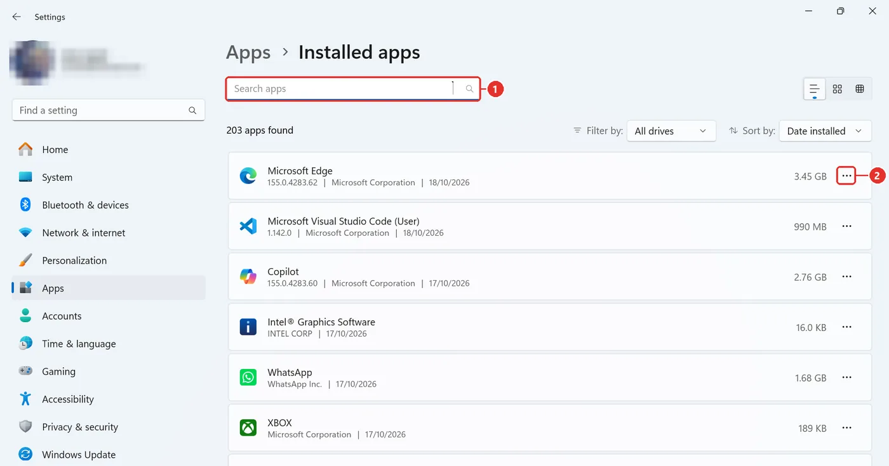

> ### Careful
> Never install a program from a website you do not know. Viruses often come that way.

## 5. Your laptop's specifications

[[Win+I]] → **System** → **About**. This is the same picture as in lesson 1:


Write down the processor ((1)), the RAM ((2)) and the storage ((3)), and compare them with the
laptop table of lesson 1. **System type** ((4)) should be 64-bit.

## 6. Shortcuts

| Keys | What they do |
|---|---|
| [[Ctrl+Z]] | Undo: takes back the last action |
| [[Ctrl+Y]] | Redo what was undone |
| [[Ctrl+S]] | Save |
| [[Ctrl+A]] | Select all |
| [[Alt+Tab]] | Switch between windows |
| [[Win+D]] | Show the desktop |
| [[Win+E]] | Open File Explorer |
| [[Win+I]] | Open Settings |
| [[Win+Space]] | Switch the keyboard language |
| [[Win+Shift+S]] | Take a screenshot |

Copy, cut and paste were in lesson 2: [[Ctrl+C]], [[Ctrl+X]] and [[Ctrl+V]].

## 7. Taking a screenshot

1. Press [[Win+Shift+S]].
2. The screen goes pale. Keep your finger on the left mouse button and move over the part you want.
3. The picture is copied. You can paste it into Word or Gmail with [[Ctrl+V]].
4. It is also saved in the **Pictures** → **Screenshots** folder.

## Lesson 4 task

1. Add Kurdish, and type your name in Kurdish in Notepad.
2. Find your laptop's specifications and compare them with the laptop table of lesson 1.
3. Take a screenshot of the About page and send it to the teacher by the university Gmail.

> **Midterm:** on a separate day after this lesson, 60 minutes, on lessons 1 to 4: online, on your laptop, in English. It is worth 24 marks.

## Check yourself — lesson 4

- [ ] I can add Kurdish and switch the language with [[Win+Space]]
- [ ] I can set the sound and the brightness
- [ ] I can put the clock and the date right
- [ ] I can remove a program
- [ ] I can find my laptop's specifications
- [ ] I can take a screenshot with [[Win+Shift+S]]

# Lesson 5 — Word, part 1

> **Today you will learn to** type Kurdish and English in Word, format text and paragraphs, and save
> your file, turn it into a PDF and print it.

## 1. Opening Word

Start → **Word** → **Blank document**. A white page opens and the cursor waits for you to type.

## 2. The face of Word

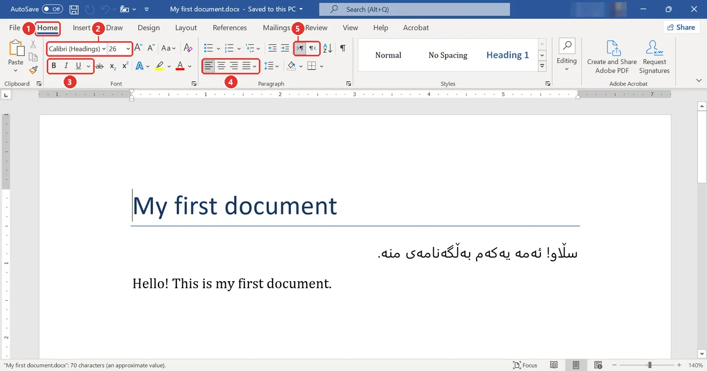

| Number | What it is | What it does |
|---|---|---|
| ((1)) | The Home tab | Most of the buttons you need today are here |
| ((2)) | Font and size | The kind of letters and how big they are |
| ((3)) | Bold, Italic and Underline | Thick letters, slanted letters, and a line underneath |
| ((4)) | Paragraph alignment | Left, centre, right, and both sides |
| ((5)) | Text direction | An English line from the left, a Kurdish line from the right |

## 3. Typing Kurdish and English

1. Choose the keyboard language with [[Win+Space]], as in lesson 4.
2. For a Kurdish line, press the **Right-to-Left** button ((5)), so the line starts from the right.
3. For a new paragraph, press [[Enter]].

> For Kurdish text a font such as **Segoe UI** is good, because it has every Kurdish letter.

## 4. Font, size and colour

First **select** the text: keep your finger on the left mouse button and move over the text, or
[[Ctrl+A]] for all of it. Then:

| Action | Button | Keys |
|---|---|---|
| Font and size | ((2)) | — |
| Bold | **B** | [[Ctrl+B]] |
| Italic | *I* | [[Ctrl+I]] |
| Underline | U | [[Ctrl+U]] |
| Font colour | **A** with a red line | — |

## 5. Paragraphs

- **Alignment** ((4)): left [[Ctrl+L]], centre [[Ctrl+E]], right [[Ctrl+R]], both sides [[Ctrl+J]].
- **Line spacing:** the **Line and Paragraph Spacing** button is next to the alignment buttons;
  choose 1.0 or 1.5.

## 6. Saving and opening

1. Press [[Ctrl+S]].
2. The first time, type the file's name and choose where it goes, for example your own folder in
   **Documents**.
3. Click **Save**. From then on [[Ctrl+S]] saves it quietly.

To open a file: double-click it in File Explorer, or in Word → **File** → **Open**.

## 7. Saving as PDF

1. **File** → **Save As** → **Browse**.
2. In **Save as type**, choose **PDF**.
3. Click **Save**.

**Why PDF?** It looks the same on every computer and phone and is not easily changed, so it is
better for sending.

## 8. Printing

Press [[Ctrl+P]] → choose the printer → type the number of copies → **Print**. The pages are shown
on the right; look at them before printing.

## Lesson 5 task

Write a simple CV for yourself: name, phone number, university e-mail, studies and skills. Make
your name big and bold. Save it in your own folder, as Word and as PDF.

> **Quiz 1:** at the start of lesson 6, on this lesson: online, in English, on a Word file you download.

## Check yourself — lesson 5

- [ ] I can type Kurdish and English in Word
- [ ] I can change the font, the size and the colour of text
- [ ] I can align a paragraph
- [ ] I can save my file and open it again
- [ ] I can save my file as PDF
- [ ] I know how to print it

# Lesson 6 — Word, part 2

> **Today you will learn to** write a complete report: headings, page numbers, a table and a picture,
> and page setup, then send it by the university Gmail.

## 1. Headings

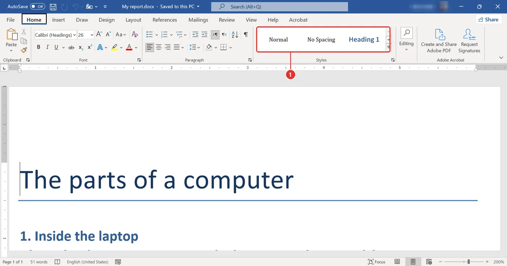

1. Click in the heading's line.
2. In **Styles** ((1)), choose **Heading 1** for a main heading, or **Heading 2** for a smaller one.

**Why Heading and not just big letters?** Word knows them as headings: in **View** → **Navigation
Pane** you see them listed and reach each one with a click.

## 2. Tables, pictures and page numbers

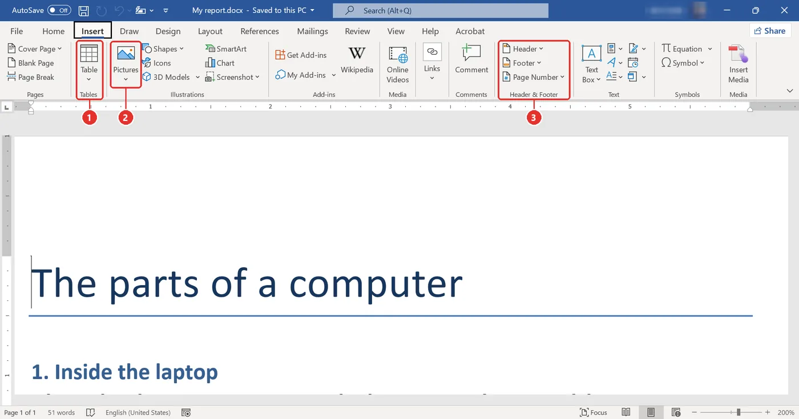

- **Table** ((1)): **Insert** → **Table** → move the mouse over the squares for the number of
  columns and rows, then click. To go to the next cell, press [[Tab]].
- **Picture** ((2)): **Insert** → **Pictures** → **This Device** → choose the picture → **Insert**.
  To make it bigger or smaller, drag a corner.
- **Page numbers** ((3)): **Insert** → **Page Number** → **Bottom of Page** → choose a style. Here
  are **Header** and **Footer** too, for a line at the top or bottom of every page.

## 3. Page setup

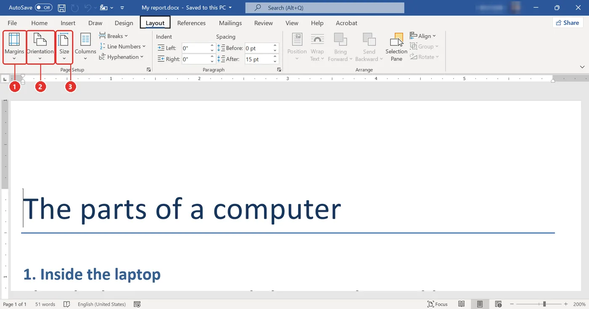

- **Margins** ((1)): the edges; **Normal** is good for a report.
- **Orientation** ((2)): **Portrait** for a tall page, **Landscape** for a wide one.
- **Size** ((3)): the paper size; **A4** is used in Kurdistan.

## 4. Sending the report

1. Save the report as PDF, as in lesson 5.
2. In the university Gmail, write a new e-mail and attach the PDF file, as in lesson 3.

## Lesson 6 task

Write a two-page report on "The parts of a computer": Heading 1 and Heading 2 headings, a table, a
picture and page numbers. Save it as PDF and send it to the teacher by the university Gmail.

> **Quiz 2:** at the start of lesson 7, on this lesson: online, in English, on a Word file you download.

## Check yourself — lesson 6

- [ ] I can make Heading 1 and Heading 2 headings
- [ ] I can make a table and fill it in
- [ ] I can put in a picture and change its size
- [ ] I can add page numbers
- [ ] I can change the margins, the orientation and the paper size
- [ ] I can send my report by Gmail

# Lesson 7 — PowerPoint

> **Today you will learn to** build a presentation: slides, a design, text and pictures, a simple
> animation, and presenting on the screen.

## 1. A new presentation

Start → **PowerPoint** → **Blank Presentation**.

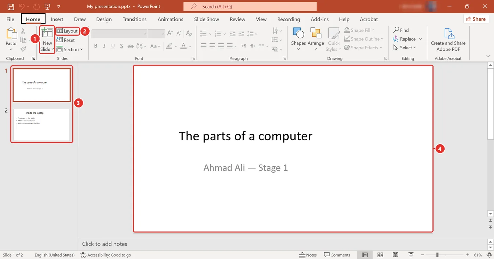

| Number | What it is | What it does |
|---|---|---|
| ((1)) | New Slide | Adds a new slide |
| ((2)) | Layout | Changes the slide's shape: a title, a title and text, two columns… |
| ((3)) | The slides, small | Click one to work on it |
| ((4)) | The slide | Click "Click to add title" and type |

## 2. Design

**Design** → choose one of the designs ((1)). Every slide changes.

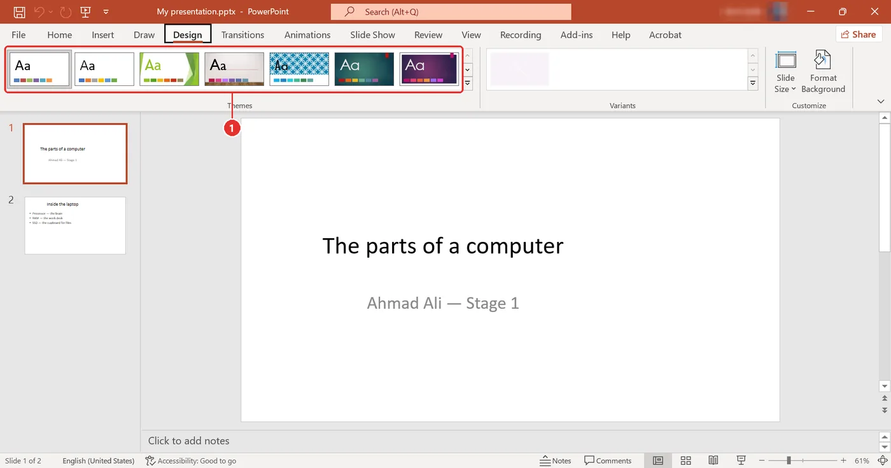

## 3. Text and pictures

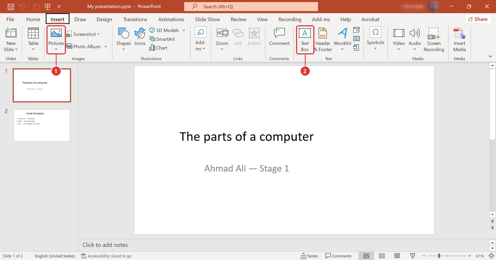

- **Picture** ((1)): **Insert** → **Pictures** → **This Device** → choose the picture.
- **Text Box** ((2)): click it, then drag on the slide and type.

> **A good slide:** few words, big letters, clear pictures. A slide is not for reading out the whole text.

## 4. A simple animation

1. Select a text or a picture on the slide.
2. **Animations** → choose a simple animation ((1)), such as **Fade** or **Appear**.
3. Press **Preview** ((2)) to see it.

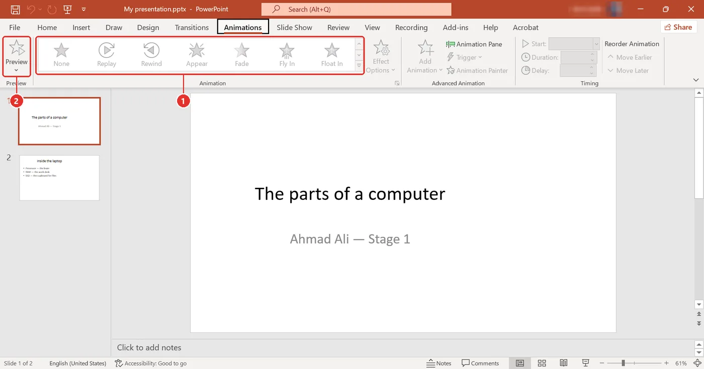

> Do not overdo animation. One simple animation for the whole presentation is enough.

## 5. Presenting

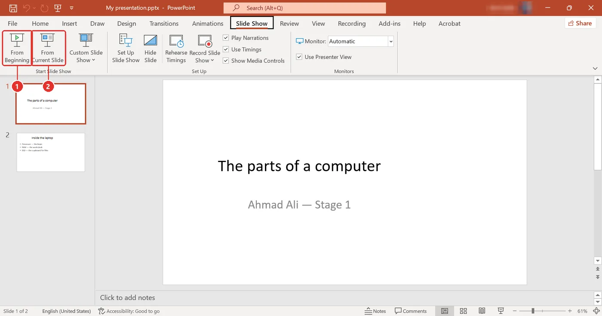

- **From Beginning** ((1)) or [[F5]]: from the first slide.
- **From Current Slide** ((2)) or [[Shift+F5]]: from the slide you are on.
- **Next slide:** click, or press [[→]] or [[Space]].
- **The end:** [[Esc]].

## Lesson 7 task

A five-slide presentation on a subject you choose: a title slide, three content slides with
pictures, and a closing slide. Use a design and one animation. Save it in your own folder.

## The report — the final project

This is homework: choose a subject, write a report on it in Word, build a presentation on it in
PowerPoint, and send both files to the teacher by the university Gmail. It is your report mark:
16 of the 100. The teacher gives the last day to send it.

> **Final:** on a separate day after this lesson, 60 minutes: online, on your laptop, in English, on a
> Word file and a PowerPoint file. It is worth 40 marks.

## Check yourself — lesson 7

- [ ] I can add a new slide and change its layout
- [ ] I can choose a design
- [ ] I can put in text and pictures
- [ ] I can add a simple animation
- [ ] I can show the presentation from the start and end it

# Appendix — Where the pictures come from

The photos of the computer's parts come from Wikimedia Commons. They are free to use, as long as
the photographer and the licence are named. The red numbers on the photos of the ports and the
keyboard were added by us.

- **Laptop:** [Lenovo ThinkPad T490.jpg](https://commons.wikimedia.org/wiki/File:Lenovo_ThinkPad_T490.jpg) — P2u111 — [CC BY 4.0](https://creativecommons.org/licenses/by/4.0)
- **Processor:** [Mainboard C5V01 LA-E892P - Intel Core i7-8550U-5911.jpg](https://commons.wikimedia.org/wiki/File:Mainboard_C5V01_LA-E892P_-_Intel_Core_i7-8550U-5911.jpg) — Raimond Spekking — [CC BY-SA 4.0](https://creativecommons.org/licenses/by-sa/4.0)
- **RAM:** [DDR 4 RAM SO-DIMM 8GB by Samsung-top front PNr°0838.jpg](https://commons.wikimedia.org/wiki/File:DDR_4_RAM_SO-DIMM_8GB_by_Samsung-top_front_PNr%C2%B00838.jpg) — D-Kuru — [CC BY-SA 4.0](https://creativecommons.org/licenses/by-sa/4.0)
- **SSD:** [Samsung 980 PRO PCIe 4.0 NVMe SSD 1TB-top PNr°0915.jpg](https://commons.wikimedia.org/wiki/File:Samsung_980_PRO_PCIe_4.0_NVMe_SSD_1TB-top_PNr%C2%B00915.jpg) — D-Kuru — [CC BY-SA 4.0](https://creativecommons.org/licenses/by-sa/4.0)
- **Ports:** [Acer Swift 3 rear-left edge.jpg](https://commons.wikimedia.org/wiki/File:Acer_Swift_3_rear-left_edge.jpg) — Bobulous — [CC BY-SA 4.0](https://creativecommons.org/licenses/by-sa/4.0)
- **Keyboard:** [Keyboard Lenovo ThinkPad T440p (QWERTY layout).jpg](https://commons.wikimedia.org/wiki/File:Keyboard_Lenovo_ThinkPad_T440p_%28QWERTY_layout%29.jpg) — Kambiel5 — [CC BY-SA 4.0](https://creativecommons.org/licenses/by-sa/4.0)
- **Touchpad:** [Laptop touchpad 20190320.jpg](https://commons.wikimedia.org/wiki/File:Laptop_touchpad_20190320.jpg) — Santeri Viinamäki — [CC BY-SA 4.0](https://creativecommons.org/licenses/by-sa/4.0)
- **Mouse:** [Generic computer mouse with scrollwheel.jpg](https://commons.wikimedia.org/wiki/File:Generic_computer_mouse_with_scrollwheel.jpg) — Peter Astbury — [CC0](http://creativecommons.org/publicdomain/zero/1.0/deed.en)

The screenshots were taken on a Windows 11 computer, with personal details hidden.