# ڕێنمایی قوتابی — Computer Application، قۆناغی یەکەم — ئامادەکردنی مامۆستا ادریس قادر


## ئەم ڕێنماییە بۆ کێیە؟

بۆ قوتابییەک کە تازە دەست بە کۆمپیوتەر دەکات. هیچ زانیارییەکی پێشووت پێویست نییە:
ئەگەر هەرگیز دەستت لە کۆمپیوتەر نەدابێت، ئەم ڕێنماییە بۆ تۆ نووسراوە.

## چۆن بەکاری دەهێنیت

1. **لە پۆلدا** لەگەڵ مامۆستا هەنگاو بە هەنگاو بڕۆ و هەموو شتێک بە دەستی خۆت بکە.
2. **لە ماڵەوە** دووبارەی بکەرەوە. ئەم لاپەڕەیە لە مۆبایلیش دەکرێتەوە.
3. **ژمارە سوورەکانی سەر وێنەکان**، وەک ((1)) و ((2))، هەمان ژمارەن کە لە دەقەکەدا دەیانبینیت.
4. **کلیلەکانی کیبۆرد** بەم شێوەیە نووسراون: [[Enter]]. ئەگەر نووسرابوو [[Shift+A]]، واتە دەست لەسەر دوگمەی [[Shift]] دابنێ و لە هەمان کاتدا [[A]] دابگرە.
5. **لە کۆتایی هەر وانەیەک** لیستێک هەیە. هەر شتێک توانیت بیکەیت، نیشانەی ✓ی بۆ دابنێ.

## نمرەکانت

| بەش | نمرە | چییە |
|---|---|---|
| ئەرکی ماڵ | 10 | ئەرکی کۆتایی هەر وانەیەک |
| ڕاپۆرت | 16 | پڕۆژەی کۆتایی: ڕاپۆرتێک لە Word و پێشکەشکردنێک لە PowerPoint |
| کویز | 8 | دوو کویزی کورتی کرداری بە Google Forms، بە ئینگلیزی |
| میدتێرم | 24 | ئۆنلاین و کرداری، لەسەر لاپتۆپەکەت، لە ڕۆژێکی جیا دوای وانەی 4 |
| چالاکی | 2 | کارەکانت لە ناو پۆل |
| فاینەل | 40 | ئۆنلاین و کرداری، لەسەر لاپتۆپەکەت، لە ڕۆژێکی جیا دوای وانەی 7 |
| **کۆ** | **100** | |

**پەڕەکان چۆنن:** هەموو پەڕەیەک فایلێکی هاوپێچی ئیمەیلی مامۆستای لەگەڵە. دایدەبەزێنیت، هەر کارێک
لەسەر لاپتۆپەکەت دەکەیت، و ئەوەی دەیبینیت تیک دەکەیت. وەڵامەکە تەنها دوای کردنی کارەکە دەردەکەوێت،
بۆیە لەبەر ناکرێت. هەموو پەڕەکان بە ئینگلیزین.

دوو مۆک ناژمێردرێن: بۆ ئەوەن پێشتر پەڕەی لەم جۆرە تاقی بکەیتەوە. مۆکی کویز لە کۆتایی وانەی 3 و لە
پۆلدایە؛ مۆکی فاینەل دوای وانەی 7 و لە ماڵەوەیە، و 48 کاتژمێر کراوە دەبێت.

# وانەی 1 — کۆمپیوتەر و هەڵبژاردنی لاپتۆپ

> **ئەمڕۆ فێر دەبیت** پارچەکانی کۆمپیوتەر بناسیت، لاپتۆپێکی گونجاو هەڵبژێریت، کۆمپیوتەر
> بە دروستی دابگیرسێنیت و بیکوژێنیتەوە، و ماوس و کیبۆرد بەکاربهێنیت.

## 1. کۆمپیوتەر چییە؟

کۆمپیوتەر ئامێرێکە کە کارەکانتی پێ دەکەیت: نووسین، خوێندنەوە، ناردنی (Send) ئیمەیل، سەیرکردنی
وێنە (Picture) و ڤیدیۆ، و پێشکەشکردن (Presentation).

دوو جۆری باوی هەیە:

- **کۆمپیوتەری مێز (Desktop):** شاشە (Screen)، کیبۆرد و ماوسی جیای هەیە و هەمیشە بە کارەباوە بەستراوە.
- **لاپتۆپ (Laptop):** هەموو پارچەکانی لە یەک ئامێردان، پاتری هەیە و لەگەڵ خۆت هەڵیدەگریت.

لەم کۆرسەدا زیاتر لەسەر لاپتۆپ کار دەکەین.

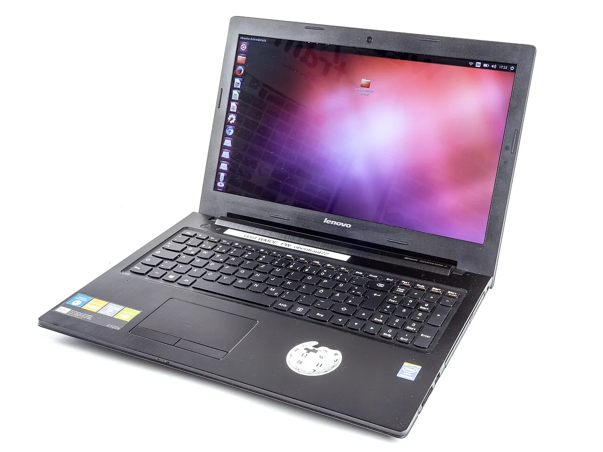

## 2. سێ پارچەی ناوەوە

ئەم سێ پارچەیە لەناو لاپتۆپدان و نایانبینیت، بەڵام کاتێک لاپتۆپ دەکڕیت، گرنگترین شتن.

### پرۆسێسەر (CPU) — مێشکی کۆمپیوتەر

هەموو کارێک پرۆسێسەر دەیکات. خێرایی کۆمپیوتەر بەشی زۆری بەم پارچەیەوە بەندە.

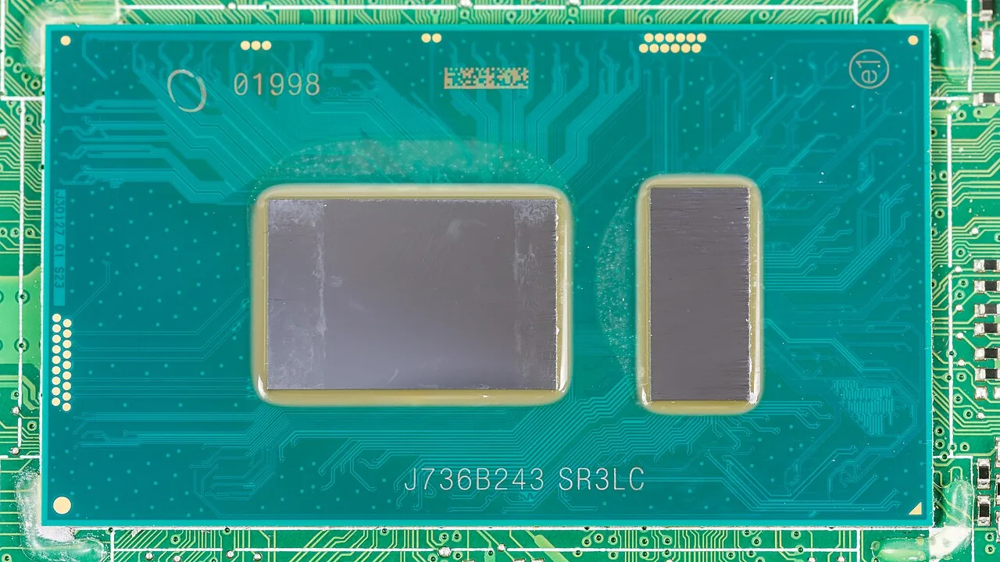

### ڕام (RAM) — مێزی کارکردن

وەک مێزێک وایە کە کارەکانی ئێستاتی لەسەر دادەنێیت. هەتا گەورەتر بێت، دەتوانیت بەرنامەی (Program)
زیاتر پێکەوە بکەیتەوە. کاتێک کۆمپیوتەر دەکوژێنیتەوە، ڕام بەتاڵ دەبێتەوە.

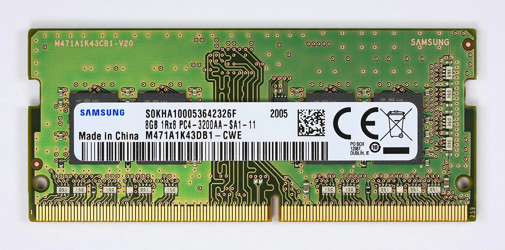

### بیرگە (SSD) — کەنتۆری فایلەکان

فایل و بەرنامەکانت لێرە دەمێننەوە، تەنانەت کاتێک کۆمپیوتەر کوژاوەتەوە. **SSD** زۆر خێراترە
لە **هارد (HDD)**ـی کۆن، بۆیە لە لاپتۆپی نوێدا SSD هەڵبژێرە.

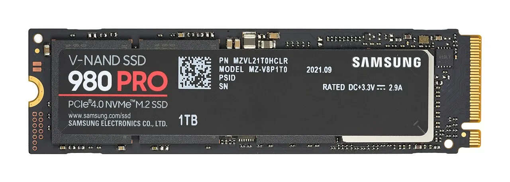

> **بە کورتی:** پرۆسێسەر = مێشک · ڕام = مێزی کارکردن · SSD = کەنتۆر

## 3. پارچەکانی دەرەوە

- **شاشە:** ئەوەی کۆمپیوتەر پیشانی دەدات.
- **کیبۆرد:** بۆ نووسین. لە بەشی 7دا بە وردی دەیناسین.
- **تەچپاد:** ماوسی ناو لاپتۆپ. پەنجەت لەسەری بجوڵێنە، نیشانەکەری ماوس (کورسەر) لەسەر شاشە دەجوڵێت.
- **ماوس:** هەمان کاری تەچپاد دەکات، بەڵام بۆ زۆر کەس ئاسانترە.

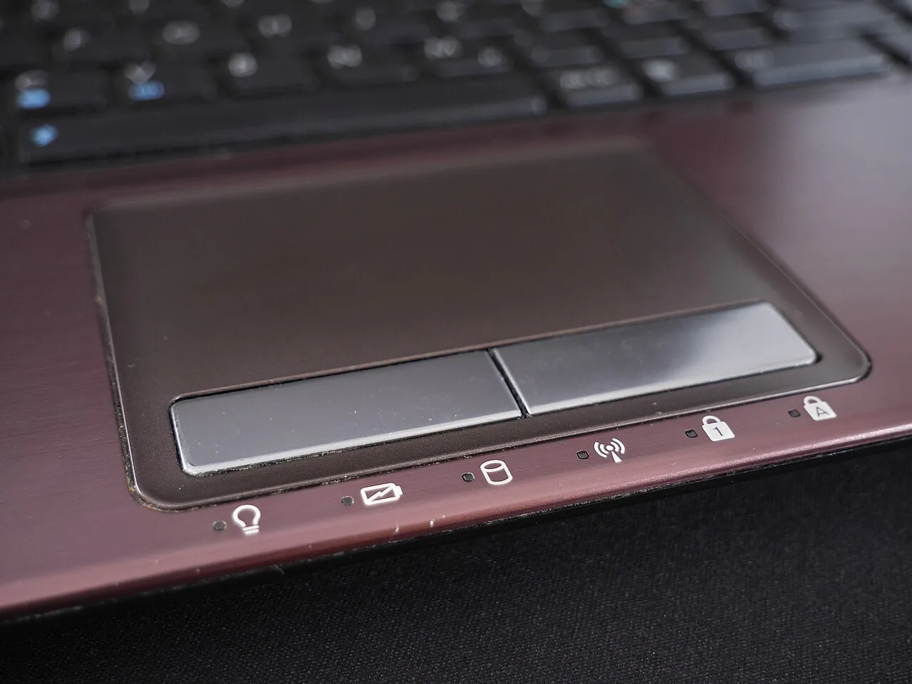

{small}

### پۆرتەکان — شوێنی بەستنەوەی ئامێرەکان

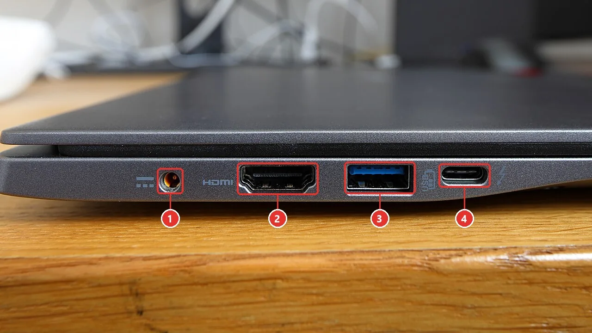

| ژمارە | پۆرت | بۆ چییە |
|---|---|---|
| ((1)) | شەحن | بەستنەوەی شەحنەکە. هەندێک لاپتۆپ بە USB-C شەحن دەکرێن |
| ((2)) | HDMI | بەستنەوەی شاشەیەکی گەورە یان پرۆجێکتەر |
| ((3)) | USB | فلاشمێموری، ماوس، کیبۆرد و چاپکەر |
| ((4)) | USB-C | پۆرتی نوێ و بچووک: فلاش، شەحن یان شاشە |

> **ئەرکی کرداری:** لەسەر لاپتۆپەکەی بەردەمت ئەمانە بدۆزەوە و پەنجەیان بۆ ڕابکێشە.

- [ ] شاشە، کیبۆرد و تەچپاد
- [ ] دوگمەی (Button) داگیرساندن (Switch on)
- [ ] پۆرتی شەحن
- [ ] پۆرتی USB
- [ ] پۆرتی HDMI، ئەگەر هەبێت

## 4. هەڵبژاردنی لاپتۆپ بۆ ویندۆز 11 و ئۆفیسی 2024

ئەگەر لاپتۆپت نییە یان دەتەوێت بیگۆڕیت، ئەم خشتەیە (Table) لەگەڵ خۆت ببە بۆ دوکان.

| پارچە | ئەوەی بیکڕیت |
|---|---|
| جۆری لاپتۆپ | ThinkPad |
| پرۆسێسەر | Core i5 یان Core i7، نەوەی 8 یان نوێتر |
| ڕام | 8 GB یان 16 GB |
| بیرگە | SSD بە 256 GB یان 512 GB |

### نەوەی پرۆسێسەر چۆن دەزانیت؟

لە ناوی پرۆسێسەرەکانی Intel دا، ئەو ژمارەیەی دوای i3 یان i5 یان i7 دێت، نەوەکە پیشان دەدات:

- ئەگەر ژمارەکە بە **1** دەست پێ بکات، **دوو** ژمارەی یەکەمی نەوەکەیە: 1135 ← نەوەی 11
- ئەگەرنا، **یەکەم** ژمارەی نەوەکەیە: 8250 ← نەوەی 8

| ناوی پرۆسێسەر | نەوە | ویندۆز 11 |
|---|---|---|
| i5-7200U | 7 | ✗ وەرناگرێت |
| i5-8250U | 8 | ✓ |
| i5-10210U | 10 | ✓ |
| i5-1135G7 | 11 | ✓ |
| Core Ultra 5 | ناوی نوێی Intel | ✓ |

> ### ئاگاداری
> لاپتۆپی دەستی دووی کۆن کە پێش 2018 دروستکراوە، زۆرجار ویندۆز 11 وەرناگرێت، هەرچەندە
> هەرزانیش بێت.

### لە دوکاندا چی بکەیت؟

1. داوا بکە لاپەڕەی **Settings** ← **System** ← **About** بکەنەوە.
2. ئەم سێ شتە بپشکنە: پرۆسێسەر ((1))، ڕام ((2)) و بیرگە ((3)).
3. ئەگەر دڵنیا نەبوویت، بەرنامەی **PC Health Check** بەکاربهێنە. پێت دەڵێت ئایا ئەو لاپتۆپە ویندۆز 11 وەردەگرێت یان نا.

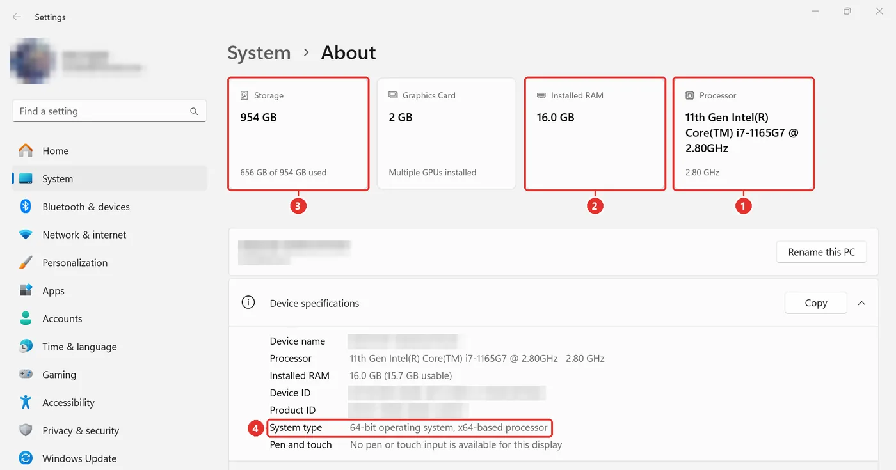

**نموونە، ئەم لاپتۆپەی سەرەوە:** پرۆسێسەر i7-1165G7 ← نەوەی 11 ✓ · ڕام 16 GB ✓ · بیرگە 954 GB ✓

## 5. داگیرساندن و کوژاندنەوە

### داگیرساندن

1. ئەگەر پاترییەکە کەمە، شەحنەکەی پێوە بکە.
2. دوگمەی داگیرساندن یەک جار دابگرە و بەری بدە.
3. چاوەڕێ بکە تا شاشەی چوونەژوورەوە (Sign in) دەردەکەوێت، پاشان PIN یان پاسۆردەکەت بنووسە و [[Enter]] دابگرە.

### کوژاندنەوەی دروست

1. کلیک لە دوگمەی **Start** بکە، لە شریتی خوارەوەی شاشە.
2. کلیک لە **Power** بکە.
3. **Shut down** هەڵبژێرە و چاوەڕێ بکە تا شاشەکە بە تەواوی ڕەش دەبێت.

| هەڵبژاردە | چی دەکات | کەی |
|---|---|---|
| **Sleep** | کۆمپیوتەر دەخەوێت؛ کارەکانت کراوە دەمێننەوە | پشوویەکی کورت |
| **Hibernate** | کارەکانت لەسەر بیرگە پاشەکەوت (Save) دەکات، پاشان بە تەواوی دەکوژێتەوە | کاتێک بۆ ماوەیەکی درێژ دایدەنێیت |
| **Shut down** | کۆمپیوتەر بە تەواوی دەکوژێتەوە | کۆتایی ڕۆژ |
| **Restart** | دەکوژێتەوە و خۆی دادەگیرسێتەوە | کاتێک کۆمپیوتەر هێواش بووە یان کێشەی هەیە |

**جیاوازی Sleep و Hibernate:** هەردووکیان کارەکانت دەپارێزن، بەڵام لە دوو شوێنی جیاواز.
دۆخی Sleep لە ڕامدا دەیانپارێزێت: خێرا دەگەڕێتەوە، بەڵام کەمێک کارەبا دەخوات، و ئەگەر پاتری
تەواو بوو کارەکانت لەدەست دەچن. دۆخی Hibernate لەسەر بیرگە دەیاننووسێت و هیچ کارەبایەک
ناخوات: سەلامەتترە، بەڵام چەند چرکەیەک زیاتری دەوێت.

> ئەگەر Hibernate لە مێنیووی **Power** دا نەبوو، ویندۆز شاردوویەتییەوە. بۆ دەرخستنی:
> **Control Panel** ← **Power Options** ← **Choose what the power buttons do** ←
> **Change settings that are currently unavailable** ← نیشانەی **Hibernate** دابنێ.

> ### هەرگیز
> بۆ کوژاندنەوە (Shut down) دوگمەی داگیرساندن بۆ چەند چرکەیەک ڕامەگرە، مەگەر کۆمپیوتەر بە تەواوی وەستابێت و هیچ
> شتێک کار نەکات. ئەوەی کراوەیە و پاشەکەوت نەکراوە، لەدەست دەچێت.

## 6. ماوس و تەچپاد

نیشانەکەری ماوس (کورسەر) تیرێکی بچووکە لەسەر شاشە. ماوسەکە یان پەنجەت لەسەر تەچپاد بجوڵێنە،
کورسەرەکەش لەگەڵیدا دەجوڵێت.

| کردار | بە ماوس | بە تەچپاد | چی دەکات |
|---|---|---|---|
| **کلیک** | دوگمەی چەپ یەک جار | یەک پەنجە یەک جار لێبدە | شتێک هەڵدەبژێرێت |
| **دوو کلیک (Double-click)** | دوگمەی چەپ دوو جار بە خێرایی | یەک پەنجە دوو جار بە خێرایی | فایل یان بەرنامە دەکاتەوە |
| **کلیکی ڕاست (Right-click)** | دوگمەی ڕاست یەک جار | دوو پەنجە پێکەوە لێبدە | مێنیوویەک دەکاتەوە |
| **ڕاکێشان (Drag)** | دەست لەسەر دوگمەی چەپ دابنێ و بیجوڵێنە | دوو جار لێبدە و لە جاری دووەمدا پەنجەت هەڵمەگرە، پاشان بیجوڵێنە | شتێک دەگوازێتەوە |
| **سکرۆڵ** | سکرۆڵی ناوەڕاست بسووڕێنە | دوو پەنجە بەرەو سەرەوە یان خوارەوە ببە | لاپەڕە دەباتە خوارەوە و سەرەوە |

ئێستا لێرە تاقی بکەرەوە. هەر کاتێک یەکێکیانت کرد، نیشانەی ✓ی سەوز دەردەکەوێت.

<!-- practice:mouse -->

> **ئەگەر کورسەرەکە ناجوڵێت:** لە زۆربەی لاپتۆپەکاندا یەکێک لە کلیلەکانی [[F1]] تا [[F12]]
> وێنەی تەچپادی لەسەرە. ئەو کلیلە تەچپاد دەکوژێنێتەوە و دایدەگیرسێنێتەوە. ئەگەر ماوسەکەت بێ وایەرە،
> پاترییەکەی بپشکنە.

## 7. کیبۆرد

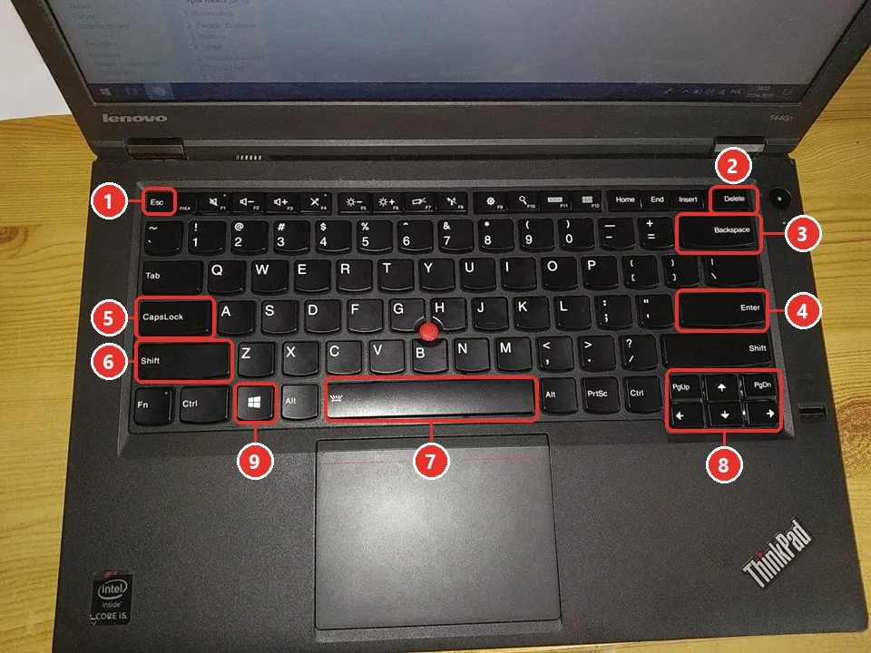

| ژمارە | کلیل | کاری |
|---|---|---|
| ((1)) | [[Esc]] | داخستنی (Close) مێنیوو، یان پەشیمانبوونەوە |
| ((2)) | [[Delete]] | سڕینەوەی (Delete) پیتی دوای کورسەر، یان سڕینەوەی فایلی هەڵبژێردراو |
| ((3)) | [[Backspace]] | سڕینەوەی پیتی پێش کورسەر |
| ((4)) | [[Enter]] | دێڕی (Line) نوێ، یان «باشە» |
| ((5)) | [[Caps Lock]] | هەموو پیتەکان گەورە دەکات؛ جارێکی تر دایبگرە بۆ گەڕانەوە |
| ((6)) | [[Shift]] | دەست لەسەر دوگمەی [[Shift]] دابنێ و پیتێک دابگرە: پیتەکە گەورە دەبێت (A)، یان هێمای سەرەوەی کلیلەکە دەنووسرێت (!) |
| ((7)) | [[Space]] | بۆشایی نێوان دوو وشە |
| ((8)) | [[←]] [[→]] [[↑]] [[↓]] | جوڵاندنی کورسەری نووسین |
| ((9)) | [[Win]] | کردنەوەی (Open) مێنیووی Start |

ئێستا لێرە تاقی بکەرەوە:

<!-- practice:keys -->

> نووسینی **کوردی** لە وانەی 4دا فێر دەبیت، کاتێک زمانی (Language) کوردی بۆ کیبۆردەکە زیاد دەکەین.

## ئەرکی وانەی 1

ناوی خۆت بە ئینگلیزی لە ڕاهێنانی کیبۆردی سەرەوەدا بنووسە. یەکەم پیتی ناوەکەت گەورە بێت، و لە
کۆتاییدا [[Enter]] دابگرە.

## خۆت بپشکنە — وانەی 1

- [ ] پرۆسێسەر، ڕام و SSD لە یەکتر جیا دەکەمەوە
- [ ] دەزانم لاپتۆپێک ویندۆز 11 وەردەگرێت یان نا
- [ ] لاپتۆپ بە دروستی دادەگیرسێنم و دەیکوژێنمەوە
- [ ] کلیک، دوو کلیک، کلیکی ڕاست و ڕاکێشان دەکەم
- [ ] ناوی خۆم بە ئینگلیزی و بە پیتی گەورە دەنووسم

# وانەی 2 — ویندۆز و فایلەکان

> **ئەمڕۆ فێر دەبیت** شریتی Taskbar و مێنیووی Start بناسیت، پەنجەرەکان بەڕێوەببەیت، فۆڵدەر
> دروست بکەیت، جۆری فایل بناسیت، فایل کۆپی و پەیست بکەیت، و فلاشمێموری بەکاربهێنیت.

## 1. دێسکتۆپ و شریتی Taskbar

کاتێک کۆمپیوتەر دادەگیرسێت، یەکەم شت کە دەیبینیت **دێسکتۆپ**ە، واتە ڕووی شاشەکە. لە خوارەوەی
شاشە (Screen) شریتێک هەیە بە ناوی **Taskbar**.

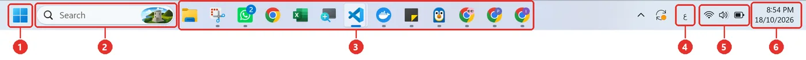

| ژمارە | چییە | چی دەکات |
|---|---|---|
| ((1)) | دوگمەی (Button) Start | مێنیووی Start دەکاتەوە |
| ((2)) | گەڕان (Search) | بەرنامە (Program)، فایل یان ڕێکخستنێک (Settings) بە ناوەکەی دەدۆزێتەوە |
| ((3)) | بەرنامەکان | بەرنامە کراوەکان و ئەوانەی جێگیر کراون؛ کلیکێک دەیانکاتەوە |
| ((4)) | زمانی (Language) کیبۆرد | زمانی نووسینی ئێستا پیشان دەدات |
| ((5)) | Wi-Fi، دەنگ (Sound) و پاتری | باری ئینتەرنێت، دەنگ و پاترییەکە |
| ((6)) | کاتژمێر (Clock) و بەروار (Date) | کات و بەرواری ئەمڕۆ |

> لەم وێنەیەدا شریتەکە لە لای چەپە. لە زۆربەی لاپتۆپەکاندا دوگمەی Start و بەرنامەکان لە ناوەڕاستن،
> بەڵام هەمان کار دەکەن.

## 2. مێنیووی Start

کلیک لە دوگمەی Start بکە، یان کلیلی [[Win]] دابگرە.

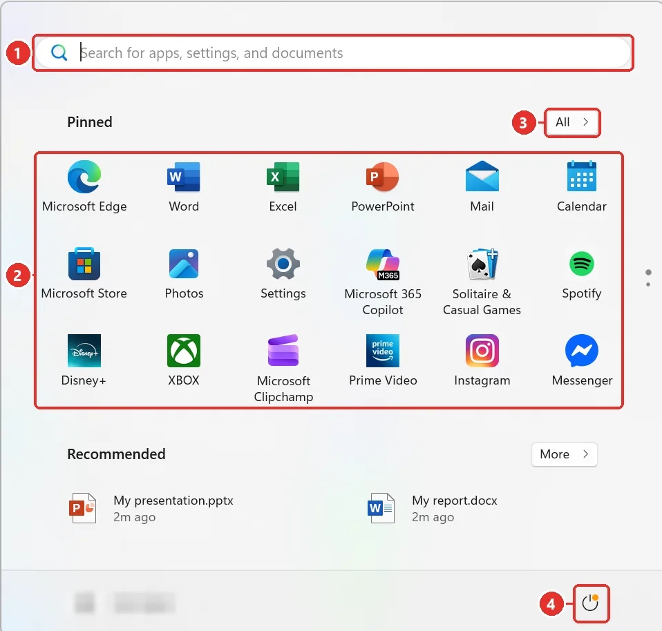

- **گەڕان** ((1)): ناوی بەرنامەکە بنووسە، بۆ نموونە Word، و [[Enter]] دابگرە.
- **بەرنامە جێگیرکراوەکان** ((2)): کلیک لە هەر یەکێکیان بکە، دەکرێتەوە.
- **هەموو بەرنامەکان** ((3)): دوگمەی All لیستی هەموو بەرنامەکان پیشان دەدات.
- **Power** ((4)): بۆ Sleep و Hibernate و Shut down و Restart، وەک لە وانەی 1دا فێری بوویت.

## 3. پەنجەرەکان

هەر بەرنامەیەک لە ناو **پەنجەرەیەک (Window)**دا دەکرێتەوە. لە گۆشەی سەرەوەی لای ڕاستی هەر پەنجەرەیەک سێ
دوگمە هەن، ژمارە ((6)) لە وێنەی (Picture) بەشی 4:

| دوگمە | ناوی | چی دەکات |
|---|---|---|
| — | Minimize | پەنجەرەکە دەشارێتەوە بۆ Taskbar؛ کلیک لە بەرنامەکە لە Taskbar دەیگەڕێنێتەوە |
| ☐ | Maximize | پەنجەرەکە هەموو شاشەکە دەگرێت؛ جارێکی تر دەیگەڕێنێتەوە بۆ قەبارەی (Size) پێشووی |
| ✕ | Close | بەرنامەکە دادەخات |

- **گۆڕین لە نێوان پەنجەرەکاندا:** کلیک لە بەرنامەکە لە Taskbar بکە، یان دەست لەسەر دوگمەی
  [[Alt]] دابنێ و [[Tab]] دابگرە.
- **جوڵاندنی پەنجەرە:** دەست لەسەر دوگمەی چەپی ماوس دابنێ لە شریتی سەرەوەی پەنجەرەکە و بیجوڵێنە.

## 4. بەرنامەی File Explorer: فایل و فۆڵدەر

بیر لە مێزی خوێندنەکەت بکەرەوە:

- **فایل:** وەک یەک پەڕە وایە. هەر کارێک کە پاشەکەوتی (Save) دەکەیت فایلێکە، وەک نامەیەک، وێنەیەک یان
  پێشکەشکردنێک (Presentation).
- **فۆڵدەر:** وەک جانتایەک وایە کە پەڕەکانی تێدا ڕێک دەخەیت. فۆڵدەر دەتوانێت فۆڵدەری تریشی تێدا
  بێت، وەک جانتایەک کە جانتای بچووکتری تێدایە.
- **جیاکردنەوەیان:** فۆڵدەر وێنۆچکەیەکی زەردی هەیە. فایل وێنۆچکەی ئەو بەرنامەیەی هەیە کە دەیکاتەوە،
  وەک **W** ی شین بۆ Word.
- **شوێنی فایل:** وەک ناونیشانی (Address) ماڵ وایە. لە وێنەکەی خوارەوەدا ((1)) دەڵێت **Documents** ←
  **Ahmad Ali**: فۆڵدەری Ahmad Ali لە ناو Documents دایە، و فایلەکان لە ناو Ahmad Ali دان.

بۆ کردنەوەی (Open) File Explorer کلیک لە وێنەی فۆڵدەرە زەردەکە بکە لە Taskbar، یان [[Win+E]] دابگرە.

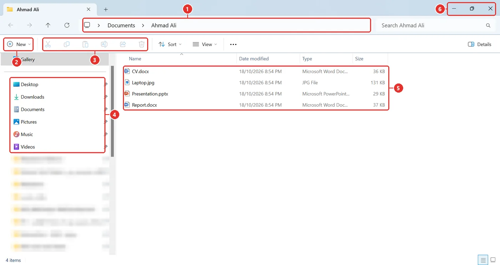

| ژمارە | چییە | چی دەکات |
|---|---|---|
| ((1)) | شوێنی ئێستا | پیشان دەدات لە کوێیت: **Documents** ← **Ahmad Ali** |
| ((2)) | دوگمەی New | فۆڵدەرێکی نوێ یان فایلێکی نوێ دروست دەکات |
| ((3)) | دوگمەکانی کار | بڕین (Cut)، کۆپی، پەیست، ناوگۆڕین (Rename)، هاوبەشکردن و سڕینەوە (Delete) |
| ((4)) | فۆڵدەرە سەرەکییەکان | Desktop، Downloads، Documents، Pictures، Music و Videos |
| ((5)) | ناوەڕۆک | ئەو فایل و فۆڵدەرانەی لەم شوێنەدان |
| ((6)) | دوگمەکانی پەنجەرە | بچووککردنەوە (Minimize)، گەورەکردن (Maximize) و داخستن (Close) |

### دروستکردنی فۆڵدەر

1. لە لای چەپ کلیک لە **Documents** بکە.
2. کلیک لە **New** ((2)) بکە و **Folder** هەڵبژێرە. ڕێگایەکی تر: کلیکی ڕاست (Right-click) لە شوێنێکی بەتاڵ ←
   **New** ← **Folder**.
3. ناوی خۆت بنووسە و [[Enter]] دابگرە.

### ناوگۆڕین، سڕینەوە و گەڕاندنەوە

- **ناوگۆڕین:** کلیک لە فایلەکە بکە ← [[F2]] دابگرە ← ناوی نوێ بنووسە ← [[Enter]].
- **سڕینەوە:** کلیک لە فایلەکە بکە ← [[Delete]] دابگرە. فایلەکە دەچێتە **Recycle Bin**.
- **گەڕاندنەوە (Restore):** لە دێسکتۆپ دوو کلیک (Double-click) لە **Recycle Bin** بکە ← کلیکی ڕاست لە فایلەکە ← **Restore**.

### جۆری فایل: پاشگر

ناوی هەر فایلێک دوو بەشە و خاڵێک لە نێوانیاندایە، بۆ نموونە **CV.docx**:

| بەش | لە نموونەکەدا | چییە |
|---|---|---|
| ناو | CV | ئەوەی خۆت دایدەنێیت، و دەتوانیت بیگۆڕیت |
| پاشگر (Extension) | .docx | جۆری فایلەکە: بە ویندۆز دەڵێت بە کام بەرنامە بیکاتەوە |

**بە نموونەیەکی ئاسان:** پاشگر وەک لەیبڵی سەر قوتوویەک وایە. ئەگەر لەیبڵی قوتوویەکی هەنگوین بکەیت بە
«خوێ»، ناوەڕۆکەکەی هەر هەنگوینە، تەنها کەس نازانێت چییە. ئەگەر **.docx** بگۆڕیت بۆ **.pdf** هەمان شت
ڕوو دەدات: فایلەکە نابێت بە PDF، تەنها ویندۆز نازانێت بە چی بیکاتەوە.

| پاشگر | جۆری فایل | بە چی دەکرێتەوە |
|---|---|---|
| .docx | بەڵگەنامە | Word |
| .pptx | پێشکەشکردن | PowerPoint |
| .pdf | بەڵگەنامەیەک بۆ خوێندنەوە و چاپکردن (Print) | Edge یان Chrome |
| .jpg و .png | وێنە | Photos |
| .zip و .rar | چەند فایلێک لە ناو یەک فایلدا | File Explorer یان WinRAR، لە وانەکانی 3 و 4 |
| .exe | بەرنامەیەک، یان دامەزرێنەری بەرنامەیەک | خۆی کار دەکات، لە وانەی 4 |

### دەرخستنی پاشگر

ویندۆز لە بنەڕەتدا پاشگر دەشارێتەوە و تەنها **CV** پیشان دەدات. بۆ دەرخستنی:

1. لە File Explorer کلیک لە **View** بکە، لە شریتی سەرەوە.
2. لە خوارەوەی لیستەکە کلیک لە **Show** بکە.
3. کلیک لە **File name extensions** بکە تا نیشانەی ✓ لە تەنیشتی دەردەکەوێت.

ئێستا ناوەکان وەک وێنەکەی سەرەوە دەبینیت، لە ((5)) دا: **CV.docx**، **Laptop.jpg** و
**Presentation.pptx**. ستوونی **Type** یش جۆری هەر فایلێک دەڵێت.

### ناوگۆڕین و چاککردنەوەی پاشگر

کاتێک پاشگر دیارە، [[F2]] تەنها ناوەکە هەڵدەبژێرێت، نەک پاشگرەکە. تەنها ئەو بەشە بگۆڕە. ئەگەر
پاشگرەکەت گۆڕی، ویندۆز ئەم پرسیارە دەکات:

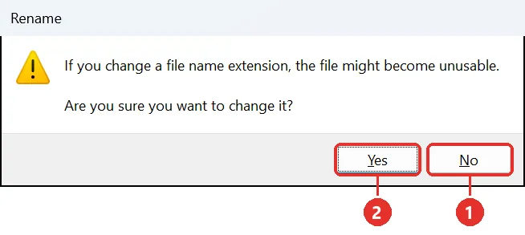

واتە: «ئەگەر پاشگرەکە بگۆڕیت، لەوانەیە فایلەکە ئیتر کار نەکات. دڵنیایت؟» ئەگەر بە هەڵە بوو، کلیک لە
**No** ((1)) بکە.

**چاککردنەوە:** ئەگەر پاشگرێکی هەڵەت دانا و فایلەکە ناکرێتەوە:

1. کلیک لە فایلەکە بکە و [[F2]] دابگرە.
2. پاشگرە هەڵەکە بسڕەوە و ڕاستەکەی بنووسە. ئەگەر بە Word دروستت کردبوو، پاشگرەکەی **.docx** ـە؛
   ئەگەر بە PowerPoint، **.pptx** ـە.
3. [[Enter]] دابگرە، و لە پرسیارەکەدا کلیک لە **Yes** ((2)) بکە.

فایلەکە وەک جاران دەکرێتەوە، چونکە ناوەڕۆکەکەی هەرگیز نەگۆڕابوو.

**گۆڕینی جۆر بە دروستی:** بۆ ئەوەی فایلێک بکەیت بە جۆرێکی تر، لە ناو بەرنامەکەدا **Save As**
بەکاربهێنە و جۆرە نوێیەکە هەڵبژێرە. بۆ نموونە لە وانەی 5 دا Word بە **Save As** فایلەکە دەکات بە PDF.

> ### ئاگاداری
> گۆڕینی پاشگر جۆری فایل ناگۆڕێت، تەنها تێکی دەدات. بۆ گۆڕینی جۆر، **Save As** بەکاربهێنە.

## 5. کۆپی، بڕین و پەیست

| کار | بە ماوس | بە کیبۆرد | ئەنجام |
|---|---|---|---|
| **کۆپی** | کلیکی ڕاست ← **Copy** | [[Ctrl+C]] | فایلەکە لە شوێنی خۆی دەمێنێت و وێنەیەکی ئامادە دەبێت |
| **بڕین** | کلیکی ڕاست ← **Cut** | [[Ctrl+X]] | فایلەکە ئامادە دەبێت تا بگوازرێتەوە |
| **پەیست** | کلیکی ڕاست ← **Paste** | [[Ctrl+V]] | فایلەکە لە شوێنە نوێیەکە دادەنرێت |

> لە ویندۆز 11دا، لە سەرەوەی مێنیووی کلیکی ڕاست، Cut و Copy و Paste و Rename وەک وێنۆچکەی بچووک
> دەردەکەون، بێ ناو. هەمان دوگمەکانی ((3))ن.

بۆ هەڵبژاردنی (Select) چەند فایلێک پێکەوە: دەست لەسەر دوگمەی [[Ctrl]] دابنێ و کلیک لە فایلەکان بکە. بۆ
هەڵبژاردنی هەموویان: [[Ctrl+A]].

## 6. فلاشمێموری

1. فلاشەکە بخە ناو پۆرتێکی USB.
2. لە File Explorer کلیک لە **This PC** ((2)) بکە. فلاشەکە لە تەنیشت دیسکەکانەوە ((1)) دەردەکەوێت،
   بە ناوێکی وەک **USB Drive**.
3. فایلەکەت کۆپی بکە، دوو کلیک لە فلاشەکە بکە، و پەیستی بکە.
4. **دەرهێنانی بە سەلامەتی:** کلیکی ڕاست لە فلاشەکە بکە ← **Eject**، پاشان دەری بهێنە.

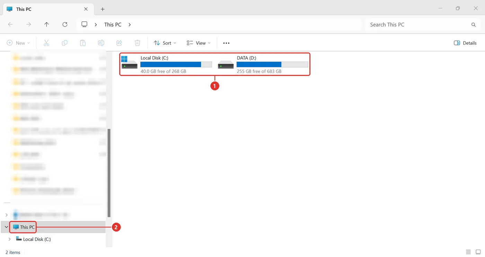

> ### ئاگاداری
> لە کاتی کۆپیکردندا فلاشەکە دەرمەهێنە، ئەگەرنا لەوانەیە فایلەکان تێک بچن.

## ئەرکی وانەی 2

1. لە **Documents** فۆڵدەرێک بە ناوی خۆت دروست بکە.
2. لە ناویدا دوو فۆڵدەری تر دروست بکە: **Lessons** و **Pictures**.
3. وێنەیەک لە فۆڵدەری Pictures ی کۆمپیوتەرەکە کۆپی بکە و لە فۆڵدەرە نوێیەکەتدا پەیستی بکە.
4. ناوی وێنەکە بگۆڕە.
5. پاشگری فایلەکان دەربخە و سەیری وێنەکەت بکە: پاشگرەکەی **.jpg** ـە یان **.png**؟
6. هەموو فۆڵدەرەکەت بۆ فلاش کۆپی بکە و فلاشەکە بە سەلامەتی دەربهێنە.

## خۆت بپشکنە — وانەی 2

- [ ] پەنجەرە بچووک و گەورە دەکەم و دایدەخەم
- [ ] لە نێوان پەنجەرەکاندا دەگەڕێم
- [ ] فۆڵدەر دروست دەکەم و ناوی دەگۆڕم
- [ ] فایل کۆپی و پەیست دەکەم، بە ماوس و بە کیبۆرد
- [ ] فایلێکی سڕاوە لە Recycle Bin دەگەڕێنمەوە
- [ ] پاشگری فایل دەردەخەم و دەزانم هەر جۆرێک بە چی دەکرێتەوە
- [ ] ئەگەر پاشگرێک بە هەڵە گۆڕدرا، چاکی دەکەمەوە
- [ ] فلاش بەکاردەهێنم و بە سەلامەتی دەری دەهێنم

# وانەی 3 — ئینتەرنێت و جیمەیلی زانکۆ

> **ئەمڕۆ فێر دەبیت** بە Wi-Fi ـەوە پەیوەست ببیت، وێبگەڕی (Browser) Chrome بەکاربهێنیت، بچیتە ناو
> جیمەیلی زانکۆکەت، بزانیت ئەگەر پاسۆردەکەت لەبیر چوو چی بکەیت، و ئیمەیل بە فایلێکەوە بنێریت.

## 1. پەیوەستبوون بە Wi-Fi

1. لە Taskbar کلیک لە وێنۆچکەی Wi-Fi بکە، ژمارە ((5)) لە وێنەی (Picture) Taskbar ی وانەی 2.
2. تیری تەنیشت Wi-Fi دابگرە تا لیستی تۆڕەکان (Network) دەردەکەوێت.
3. تۆڕەکە هەڵبژێرە ← **Connect** ← پاسۆردی Wi-Fi بنووسە ← **Next**.

ڕێگایەکی تر: [[Win+I]] ← **Network & internet** ← **Wi-Fi**.

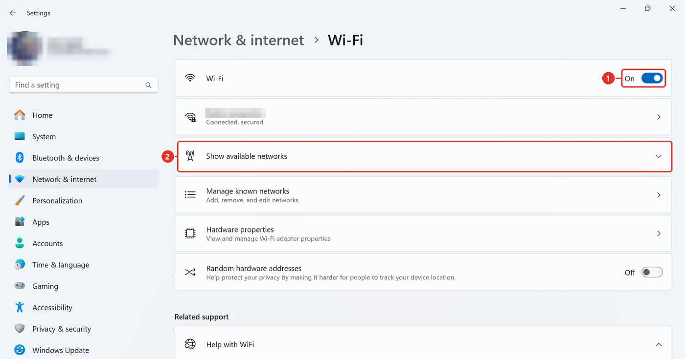

- **Wi-Fi** ((1)): دەبێت **On** بێت.
- **Show available networks** ((2)): لیستی تۆڕەکان پیشان دەدات.

> پاسۆردی Wi-Fi پیتی گەورە و بچووکی جیایە: A و a وەک یەک نین.

## 2. وێبگەڕی Chrome

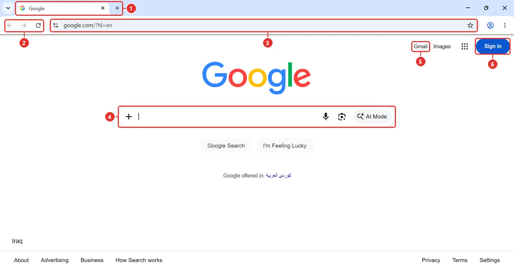

| ژمارە | چییە | چی دەکات |
|---|---|---|
| ((1)) | تاب و دوگمەی (Button) + | هەر تابێک ماڵپەڕێکە؛ + تابێکی نوێ دەکاتەوە |
| ((2)) | گەڕانەوە، پێشەوە و نوێکردنەوە | دەگەڕێیتەوە بۆ لاپەڕەی پێشوو، یان لاپەڕەکە نوێ دەکەیتەوە |
| ((3)) | شریتی ناونیشان (Address) | ناونیشانی ماڵپەڕ لێرە دەنووسیت، وەک gmail.com |
| ((4)) | گەڕانی Google | پرسیار یان وشەیەک بنووسە بۆ گەڕان (Search) |
| ((5)) | Gmail | ڕاستەوخۆ دەتباتە جیمەیل |
| ((6)) | Sign in | چوونەژوورەوە (Sign in) بۆ ئەکاونتی Google |

- **تابی نوێ:** [[Ctrl+T]] — **داخستنی (Close) تاب:** [[Ctrl+W]]
- **فایلە داگیراوەکان (Download):** [[Ctrl+J]] لیستیان دەکاتەوە. فایلەکان دەچنە فۆڵدەری **Downloads**.

## 3. چوونەژوورەوە بۆ جیمەیلی زانکۆ

پەیمانگە ئیمەیل و پاسۆردێکت پێ دەدات. ئیمەیلەکەت بە **@epu.edu.iq** کۆتایی دێت.

1. لە شریتی ناونیشانی Chrome بنووسە gmail.com و [[Enter]] دابگرە. ئەگەر لاپەڕەیەکی ناساندن
   دەرکەوت، کلیک لە **Sign in** بکە.
2. ئیمەیلەکەت بە تەواوی بنووسە ((1)) و کلیک لە **Next** ((3)) بکە.
3. پاسۆردەکەت بنووسە و دیسان **Next**.
4. ئەگەر لە یەکەم جاردا داوای پاسۆردێکی نوێی کرد، پاسۆردێکی نوێ دابنێ و دووبارەی بکەرەوە.

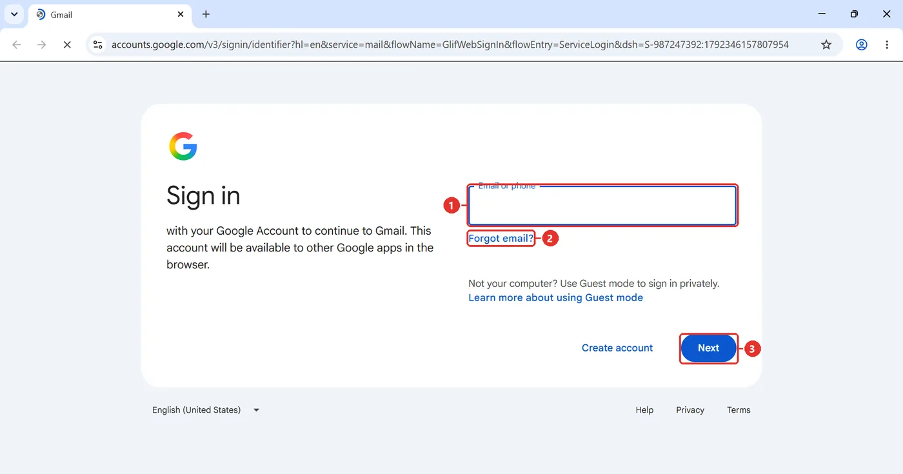

> **پاسۆردێکی باش:** لانیکەم 8 پیت، تێکەڵێک لە پیت و ژمارە. بە کەسی مەڵێ و لە شوێنێکی پارێزراو
> بینووسە.

## 4. ژمارەی مۆبایل و ئیمەیلی گەڕاندنەوە

ئەگەر ژمارەی مۆبایلەکەت و ئیمەیلێکی کەسیت دانابێت، ڕۆژێک کە پاسۆردەکەت لەبیر چوو، Google کۆدێکیان
بۆ دەنێرێت. بۆ دانانیان ئەم لاپەڕەیە بکەرەوە و بەشی **Recovery phone** و **Recovery email** بدۆزەوە:

```
https://myaccount.google.com/security
```

> ئەگەر ئەم بەشانە نەبوون یان نەگۆڕدران، زانکۆ ڕێگەی پێ نەداوە. ئەوکات بەشی 5 بەکاربهێنە.

## 5. ئەگەر پاسۆردەکەت لەبیر چوو

1. لە لاپەڕەی پاسۆرد کلیک لە **Forgot password?** بکە.
2. ئەگەر ژمارەی مۆبایل یان ئیمەیلی گەڕاندنەوەت داناوە، کۆدێکت بۆ دێت. بینووسە و پاسۆردێکی نوێ دابنێ.
3. ئەگەر ئەم ڕێگایە کاری نەکرد، بچۆ بۆ ئەو بەشەی پەیمانگە کە ئەکاونتەکەی پێ دایت.

> ئایا دەتوانیت خۆت پاسۆردەکە نوێ بکەیتەوە یان نا، بەندە بە ڕێکخستنی (Settings) زانکۆوە، نەک بە تۆ.

## 6. ناردنی ئیمەیل بە فایلی هاوپێچەوە

1. لە جیمەیل کلیک لە **Compose** بکە، لە سەرەوەی لای چەپ.
2. لە **To** ئیمەیلی وەرگرەکە بنووسە.
3. لە **Subject** بابەتی (Subject) نامەکە بنووسە.
4. دەقی نامەکە بنووسە.
5. کلیک لە وێنۆچکەی 📎 **Attach files** بکە ← فایلەکە هەڵبژێرە ← **Open**.
6. چاوەڕێ بکە تا فایلەکە بە تەواوی بار دەبێت، پاشان کلیک لە **Send** بکە.

### پاشەکەوتکردنی فایلێک کە بۆت هاتووە

1. ئیمەیلەکە بکەرەوە. فایلە هاوپێچەکان (Attachment) لە خوارەوەی نامەکەدان.
2. ماوسەکە ببە سەر فایلەکە و کلیک لە تیری **Download** بکە. فایلەکە دەچێتە فۆڵدەری **Downloads**، و
   لە Chrome کلیلی [[Ctrl+J]] لیستەکەی پیشان دەدات.
3. فایلێکی Word یان PowerPoint کە لە ئیمەیلەوە دێت، سەرەتا بە **Protected View** دەکرێتەوە و
   شریتێکی زەرد لە سەرەوەیە. لەو شریتەدا کلیک لە **Enable Editing** بکە، ئەگەر نا هیچی تێدا ناگۆڕدرێت.

### کردنەوەی فایلی zip

فایلی **zip** چەند فایل و فۆڵدەرێک لە ناو یەک فایلدا کۆ دەکاتەوە.

1. لە File Explorer کلیکی ڕاست (Right-click) لە فایلی zip بکە ← **Extract All** ← **Extract**.
2. فۆڵدەرێکی ئاسایی بە هەمان ناو دەکرێتەوە. لە ناو ئەو فۆڵدەرەدا کار بکە، نەک لە ناو zip ـەکەدا.

فایلی **rar** یش وەک zip ـە. ویندۆز 11 بە هەمان **Extract All** دەیکاتەوە؛ بەرنامەی (Program) WinRAR لە وانەی 4
دا دێت.

## 7. دەرچوون لە کۆمپیوتەری هاوبەش

- **دەرچوون (Sign out):** کلیک لە وێنەی ئەکاونتەکەت بکە لە گۆشەی سەرەوەی لای ڕاست ← **Sign out**.
- **پاسۆرد پاشەکەوت (Save) مەکە:** ئەگەر Chrome پرسی **Save password?**، کلیک لە **Never** بکە.

## ئەرکی وانەی 3

ئیمەیلێک بۆ مامۆستا بنێرە. بابەتەکەی «وانەی 3 — ناوی خۆت» بێت، و فایلێکی هاوپێچی هەبێت، بۆ نموونە
وێنەکەی ئەرکی وانەی 2.

> **مۆکی کویز:** لە کۆتایی ئەم وانەیەدا، بە Google Forms و بێ نمرە: پەڕەیەکی کرداری تاقی دەکەیتەوە،
> لەگەڵ فایلێک لە ئیمەیلی مامۆستاوە.

## خۆت بپشکنە — وانەی 3

- [ ] بە Wi-Fi ـەوە پەیوەست دەبم
- [ ] لە Chrome ناونیشانێک دەنووسم و تابی نوێ دەکەمەوە
- [ ] دەچمە ناو جیمەیلی زانکۆکەم
- [ ] دەزانم ئەگەر پاسۆردەکەم لەبیر چوو چی بکەم
- [ ] ئیمەیل بە فایلی هاوپێچەوە دەنێرم
- [ ] لە کۆمپیوتەری هاوبەشدا دەردەچم
- [ ] فایلی هاوپێچ پاشەکەوت دەکەم و فایلی zip یان rar دەکەمەوە

# وانەی 4 — ڕێکخستنەکانی ویندۆز

> **ئەمڕۆ فێر دەبیت** بە کوردی بنووسیت، دەنگ (Sound) و ڕووناکی (Brightness) و کاتژمێر (Clock) ڕێک بخەیت، بەرنامەیەکی (Program) وەک WinRAR
> دابمەزرێنیت و لایبەریت، تایبەتمەندییەکانی (Specifications) لاپتۆپەکەت بدۆزیتەوە، و وێنەی شاشە (Screenshot) بگریت.

بۆ کردنەوەی (Open) **Settings**: [[Win+I]] دابگرە، یان **Start** ← **Settings**.

## 1. زمانی کوردی

کیبۆردی کوردیی **C4kurd** لە بەشی 8 دادەمەزرێنیت، لەگەڵ فۆنتە کوردییەکان، چونکە فایلەکەیان **rar** ـە و
پێویستی بە WinRAR ـی بەشی 4 هەیە. دوای دامەزراندن (Install)، زمانی (Language) کیبۆرد بەم شێوەیە دەگۆڕیت.

### گۆڕینی زمانی کیبۆرد

- دەست لەسەر دوگمەی (Button) [[Win]] دابنێ و [[Space]] دابگرە: [[Win+Space]]
- یان [[Alt+Shift]]
- یان کلیک لە زمانەکە بکە لە Taskbar، ژمارە ((4)) لە وێنەی (Picture) Taskbar ی وانەی 2.

> پێش نووسین سەیری زمانەکە بکە لە Taskbar. ئەگەر ENG بوو، پیتەکان بە ئینگلیزی دەنووسرێن.

## 2. دەنگ و ڕووناکی

[[Win+I]] ← **System** ← **Sound**:

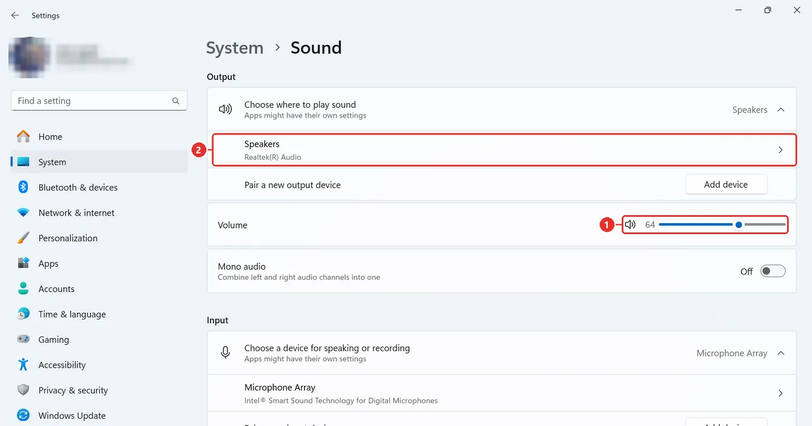

- **Volume** ((1)): بەرزی دەنگ.
- **دەنگ بۆ کوێ دەچێت** ((2)): بڵندگۆی لاپتۆپ یان هێدفۆن.

[[Win+I]] ← **System** ← **Display**:

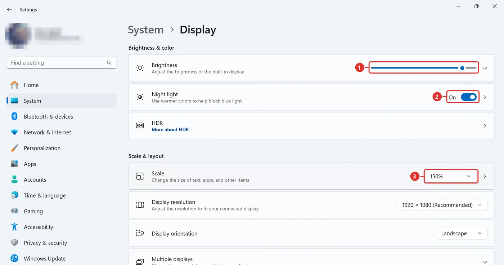

- **Brightness** ((1)): ڕووناکی شاشە (Screen).
- **Night light** ((2)): ڕەنگی (Colour) شاشە گەرمتر دەکات بۆ شەو.
- **Scale** ((3)): قەبارەی (Size) نووسین و وێنۆچکەکان. ئەگەر نووسینەکان بچووکن، گەورەتری بکە.

> لە زۆربەی لاپتۆپەکاندا کلیلەکانی [[F1]] تا [[F12]] وێنەی دەنگ و ڕووناکییان لەسەرە، و خێراتر کار دەکەن.

## 3. کات و بەروار

[[Win+I]] ← **Time & language** ← **Date & time**:

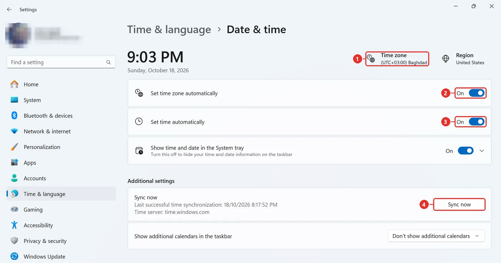

- **Time zone** ((1)): بۆ هەرێمی کوردستان (UTC+03:00) Baghdad.
- **Set time zone automatically** ((2)) و **Set time automatically** ((3)): با هەردووکیان **On** بن.
- **Sync now** ((4)): ئەگەر کاتژمێرەکە هەڵە بوو، ئەم دوگمەیە دابگرە.

## 4. دامەزراندن و لابردنی بەرنامە

**دامەزراندن لە Microsoft Store ـەوە:** دوگمەی **Start** ← **Microsoft Store** ← بەرنامەکە بگەڕێ
← **Get** یان **Install**.

**دامەزراندن لە ماڵپەڕی فەرمیی بەرنامەکەوە:**

1. ماڵپەڕە فەرمییەکە بکەرەوە و کلیک لە **Download** بکە.
2. فایلەکە دەچێتە فۆڵدەری **Downloads**. بە [[Ctrl+J]] لە Chrome دەیدۆزیتەوە.
3. دوو کلیک (Double-click) لە فایلەکە بکە. کۆتاییەکەی **.exe** یان **.msi** ـە.
4. ئەگەر ویندۆز پرسیاری **Do you want to allow this app to make changes?** کرد، کلیک لە **Yes** بکە.
5. کلیک لە **Next** بکە تا کۆتایی، پاشان **Install**، و لە دوایدا **Finish**.

**لابردنی (Uninstall) بەرنامە:** [[Win+I]] ← **Apps** ← **Installed apps** ← بەرنامەکە بدۆزەوە ((1)) ← کلیک لە
**…** ((2)) ← **Uninstall**، پاشان جارێکی تر **Uninstall** بۆ پشتڕاستکردنەوە.

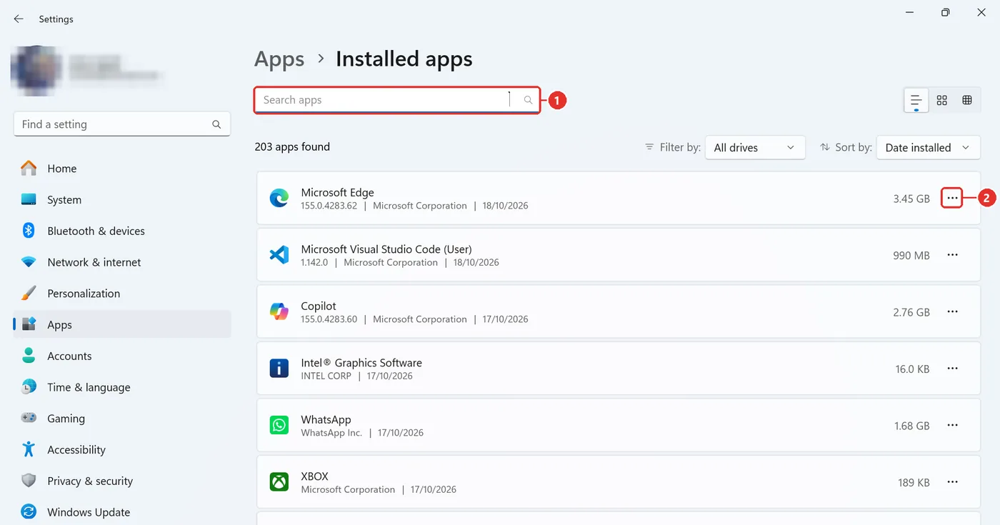

> ### ئاگاداری
> هەرگیز بەرنامە لە ماڵپەڕێکی نەناسراو دامەمەزرێنە. ڤایرۆس زۆرجار بەم شێوەیە دێت.

### نموونە: دامەزراندنی WinRAR

بەرنامەی **WinRAR** فایلی **rar** و **zip** دەکاتەوە و دروستیان دەکات.

1. لە Chrome ئەم ناونیشانە (Address) بکەرەوە. ئەمە ماڵپەڕە فەرمییەکەیەتی؛ لە هیچ ماڵپەڕێکی تر دایمەبەزێنە:

```
https://www.win-rar.com/download.html
```

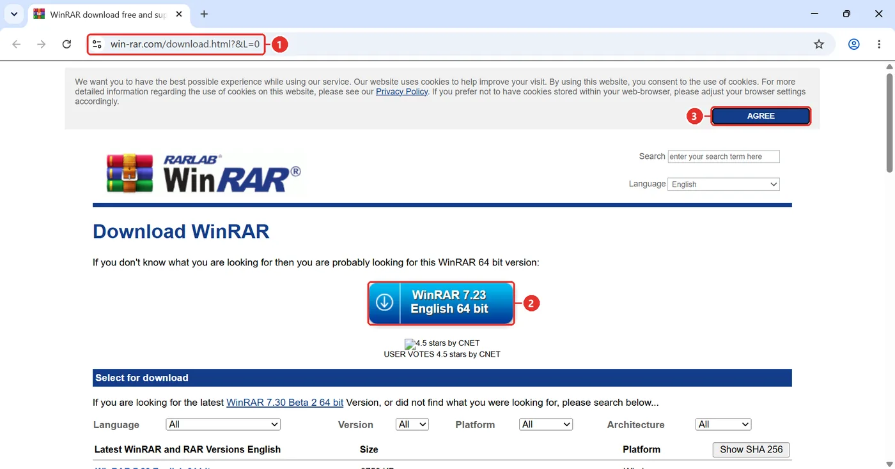

2. دڵنیابە لە شریتی ناونیشاندا نووسراوە **win-rar.com** ((1)). ئەگەر پەیامی cookies دەرکەوت، کلیک
   لە **AGREE** ((3)) بکە.
3. لە ژێر **Download WinRAR** کلیک لە دوگمە شینەکە بکە ((2))، کە لەسەری نووسراوە **WinRAR … English
   64 bit**؛ نەک لینکی **Beta**.
4. فایلەکە دەچێتە **Downloads**، بە ناوێکی وەک **winrar-x64-723.exe**. دوو کلیکی لێ بکە، و ئەگەر
   ویندۆز پرسیاری کرد، کلیک لە **Yes** بکە.
5. لە یەکەم پەنجەرەدا (Window) کلیک لە **Install** بکە.
6. پەنجەرەیەکی ڕێکخستن (Settings) دێت کە لە سەرەوەی نووسراوە **Associate WinRAR with**. هیچ مەگۆڕە و کلیک لە
   **OK** بکە.
7. لە کۆتاییدا کلیک لە **Done** بکە.

**کردنەوەی فایلی rar:** کلیکی ڕاست (Right-click) لە فایلەکە بکە:

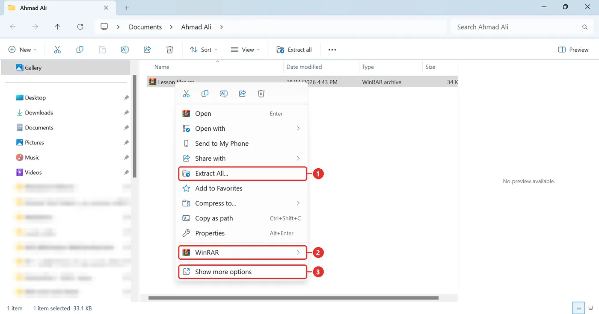

- **Extract All** ((1)): هی خودی ویندۆزە، وەک zip لە وانەی 3. بەبێ WinRAR یش هەیە.
- **WinRAR** ((2)) ← **Extract to** و ناوی فایلەکە: فۆڵدەرێکی نوێ بە هەمان ناو دروست دەکات و
  فایلەکانی تێدا دادەنێت.
- **Show more options** ((3)): ئەگەر **WinRAR** لە مێنیووەکەدا نەبوو، لێرە دەیدۆزیتەوە.

**دروستکردنی فایلی zip:** کلیکی ڕاست لە فۆڵدەرەکە بکە ← **WinRAR** ← **Add to archive…**. لە پەنجەرەکەدا،
لە **Archive format** دا **ZIP** هەڵبژێرە، و دڵنیابە ناوی فایلەکە لە سەرەوە بە **.zip** کۆتایی دێت ←
**OK**. فایلەکە لە تەنیشت فۆڵدەرەکەوە دروست دەبێت. ئەگەر **RAR** هەڵبژێردرابێت، فایلی rar دروست دەبێت.

**لە ئێستاوە:** هەر فایلێکی zip یان rar بە **WinRAR** ← **Extract to** بکەرەوە، نەک **Extract Here**. فۆڵدەرێک
بە هەمان ناوی فایلەکە دروست دەکات، بۆیە هیچ فایلێک بە پەرشوبڵاوی ناکەوێتە ناو **Downloads**.

> **پێش دامەزراندن ئەمانە بزانە:**
>
> - WinRAR بێبەرامبەر نییە: 40 ڕۆژ بە خۆڕایی تاقی دەکرێتەوە، و مەرجەکانی دەڵێن دوای ئەوە دەبێت
>   مۆڵەتەکەی بکڕدرێت. لەو کاتەدا پەنجەرەیەکی بیرخستنەوە پیشان دەدات.
> - ویندۆز 11 خۆی فایلی rar یش دەکاتەوە، بە هەمان **Extract All** ی وانەی 3. بەڵام لەم کۆرسەدا لە
>   ئێستاوە **WinRAR** ← **Extract to** بەکاردێت، و میدتێرم بەو شێوەیە دەپرسێت. بۆ دروستکردنی فایلی
>   rar و کردنەوەی فایلێکی پاسۆرددار، WinRAR پێویستە.

## 5. تایبەتمەندییەکانی لاپتۆپەکەت

[[Win+I]] ← **System** ← **About**. ئەمە هەمان وێنەی وانەی 1ە:


پرۆسێسەر ((1))، ڕام ((2)) و بیرگە ((3)) بنووسە و لەگەڵ خشتەی (Table) لاپتۆپی وانەی 1 بەراوردی بکە.
**System type** ((4)) دەبێت 64-bit بێت.

جۆری بیرگە، SSD یان HDD، لە About دا نییە: [[Ctrl+Shift+Esc]] ← **Performance** ← **Disk 0**. لە ژێر
ناوەکەیدا نووسراوە **SSD** یان **HDD**.

بۆ ناردنی (Send) ئەم تایبەتمەندییانە، لە بەشی **Device specifications** کلیک لە **Copy** بکە، پاشان لە شوێنی
خۆیدا [[Ctrl+V]] دابگرە.

## 6. کلیلە کورتەکان

| کلیل | کاری |
|---|---|
| [[Ctrl+Z]] | گەڕانەوە: دوایین کار هەڵدەوەشێنێتەوە |
| [[Ctrl+Y]] | دووبارەکردنەوەی ئەو کارەی هەڵوەشێنرایەوە |
| [[Ctrl+S]] | پاشەکەوتکردن |
| [[Ctrl+A]] | هەڵبژاردنی (Select) هەمووی |
| [[Alt+Tab]] | گۆڕین لە نێوان پەنجەرەکاندا |
| [[Win+D]] | پیشاندانی دێسکتۆپ |
| [[Win+E]] | کردنەوەی File Explorer |
| [[Win+I]] | کردنەوەی Settings |
| [[Win+Space]] | گۆڕینی زمانی کیبۆرد |
| [[Win+Shift+S]] | وێنەگرتنی شاشە |

کۆپی، بڕین (Cut) و پەیست لە وانەی 2دا هاتوون: [[Ctrl+C]]، [[Ctrl+X]] و [[Ctrl+V]].

## 7. وێنەگرتنی شاشە

1. [[Win+Shift+S]] دابگرە.
2. شاشەکە کاڵ دەبێتەوە. دەست لەسەر دوگمەی چەپی ماوس دابنێ و بەسەر ئەو بەشەدا بیجوڵێنە کە دەتەوێت.
3. وێنەکە کۆپی دەبێت. دەتوانیت لە Word یان لە جیمەیل بە [[Ctrl+V]] پەیستی بکەیت.
4. وێنەکە لە فۆڵدەری **Pictures** ← **Screenshots** یش پاشەکەوت (Save) دەبێت.

## 8. کیبۆرد و فۆنتی کوردی

ویندۆز پیتی کوردی لەگەڵ خۆیدا هەیە، بەڵام هەموو فۆنتێکی کوردی نا. فایلی **Fonts.rar** دوو شتی تێدایە:
کیبۆردی کوردیی **C4kurd**، و 40 فۆنتی **Unikurd** کە کوردی و عەرەبی بە یەک فۆنت دەنووسن، کە ئەوەیە
ڕاپۆرتێکی Word پێویستی پێیەتی.

### دابەزاندنی فایلەکە

ڤیدیۆکەی مامۆستا هەموو هەنگاوەکان پیشان دەدات:

```
https://youtu.be/Lf5kimIJSQw
```

1. فایلی **Fonts.rar** لێرەوە دابەزێنە:

```
https://drive.google.com/file/d/14mEF2fS-hfvWsQyrwcSdoQOjWBwygtn9/view
```

2. کلیکی ڕاست لە **Fonts.rar** بکە ← **WinRAR** ← **Extract to**، وەک لە بەشی 4. فۆڵدەری **Fonts** دروست
   دەبێت، و دوو فۆڵدەری تێدایە: **c4kud** و **40 Unikurd Fonts**.

### دامەزراندنی کیبۆردی کوردی

1. فۆڵدەری **c4kud** بکەرەوە و دوو کلیک لە **setup.exe** بکە. چاوەڕێ بکە تا تەواو دەبێت.
2. بە [[Win+Space]] کیبۆرد لە نێوان کوردی و ئینگلیزیدا دەگۆڕیت، وەک لە بەشی 1.

> ئەگەر ویندۆز **Windows protected your PC** ی پیشان دا: **More info** ← **Run anyway**.

### دامەزراندنی فۆنتەکان

1. فۆڵدەری **40 Unikurd Fonts** بکەرەوە و بە [[Ctrl+A]] هەر 40 فۆنتەکە هەڵبژێرە.
2. کلیکی ڕاست ← **Install for all users**. ئەگەر لە مێنیووەکەدا نەبوو، لە **Show more options** دایە.
   چەند چرکەیەک دەخایەنێت.
3. بەرنامەی Word بکەرەوە. فۆنتە نوێیەکان لە لیستی فۆنتەکاندا دەردەکەون.

> ئەگەر Word پێشتر کراوە بوو، دایبخە و دووبارە بیکەرەوە، ئەگەرنا فۆنتە نوێیەکان نابینیت.

### لابردنی فۆنت

کلیلی [[Win+I]] ← **Personalization** ← **Fonts** ← کلیک لە فۆنتەکە بکە ← **Uninstall**.

## ئەرکی وانەی 4

لە **Documents** فۆڵدەرێک بە ناوی **Lesson4** دروست بکە. هەموو ئەم ئەرکە دەچێتە ناوی، و لە کۆتاییدا
دەیکەیت بە **Lesson4.zip**. ناوی فۆڵدەر و فایلەکان وەک خۆیان بنووسە، بە ئینگلیزی.

1. کیبۆردی کوردی دابمەزرێنە، وەک لە بەشی 8. لە Notepad ناوی خۆت بە کوردی بنووسە، و لە ناو Lesson4
   بە ناوی **name.txt** پاشەکەوتی بکە.
2. لە About کلیک لە **Copy** بکە، لە Notepad ـێکی نوێدا [[Ctrl+V]] دابگرە، و لە ناو Lesson4 بە ناوی
   **specs.txt** پاشەکەوتی بکە. پاشان لەگەڵ خشتەی لاپتۆپی وانەی 1 بەراوردی بکە: پرۆسێسەر، ڕام، و SSD
   یان HDD.
3. دوو وێنەی شاشە بگرە: لاپەڕەی About، و Task Manager ← **Performance** ← **Disk 0**. لە **Pictures** ←
   **Screenshots** کۆپییان بکە بۆ Lesson4، و ناویان بگۆڕە بۆ **about.png** و **disk.png**.
4. WinRAR لەسەر **لاپتۆپەکەی خۆت** لە ماڵپەڕە فەرمییەکەیەوە دابمەزرێنە، و ئەو فایلە rar ـەی مامۆستا
   بۆی ناردوویت بە **Extract to** بکەرەوە. میدتێرم لەسەر لاپتۆپەکەی خۆتە و پێویستی پێیەتی.
5. فۆڵدەری Lesson4 بە WinRAR بکە بە **Lesson4.zip**، وەک لە بەشی 4: **Add to archive…** ← **ZIP**. پاشان
   لە **فۆڕمی ئەرکی وانەی 4** دا بینێرە، کە مامۆستا لینکەکەی بۆ جیمەیلی زانکۆکەت دەنێرێت: جۆری
   بیرگەکەت، بەراوردەکەت، و Lesson4.zip بە **Add file**. لە سەرەوەی فۆڕمەکە نووسراوە کەی دادەخرێت.
   بە هەژماری زانکۆکەت بچۆ ژوورەوە و لە کۆتاییدا **Submit** دابگرە. تا کاتی داخستن (Close) دەتوانیت
   وەڵامەکانت و فایلەکەت بگۆڕیت.

> **نمرەکەی خۆکارانە دادەنرێت:** Lesson4.zip و فۆڵدەری Lesson4 2، ناوی کوردی لە name.txt 2، specs.txt
> 1، دوو وێنەکە 2، و بەراوردەکە 3. فایلی rar نمرەی خۆکاری نییە، بۆیە ZIP هەڵبژێرە. بەراوردەکە بە
> specs.txt ی خۆت دەپشکنرێت، و ئەگەر دوو قوتابی هەمان لاپتۆپ یان هەمان وێنە بنێرن، مامۆستا دەیبینێت.

> **میدتێرم:** لە ڕۆژێکی جیا دوای ئەم وانەیە، 60 خولەک، لەسەر وانەکانی 1 تا 4: ئۆنلاین، لەسەر لاپتۆپەکەت، بە ئینگلیزی. 24 نمرەیە.

## خۆت بپشکنە — وانەی 4

- [ ] کیبۆردی کوردی دادەمەزرێنم و بە [[Win+Space]] زمانەکە دەگۆڕم
- [ ] لە Task Manager دەزانم بیرگەکەم SSD ـە یان HDD
- [ ] دەنگ و ڕووناکی ڕێک دەخەم
- [ ] کاتژمێر و بەروار (Date) ڕاست دەکەمەوە
- [ ] بەرنامەیەک دادەمەزرێنم و لایدەبەم
- [ ] WinRAR لەسەر لاپتۆپەکەی خۆم دادەمەزرێنم و فایلی rar بە Extract to دەکەمەوە
- [ ] بە WinRAR ← Add to archive فۆڵدەرێک دەکەم بە فایلی zip
- [ ] فۆنتی کوردی دادەمەزرێنم و لە Word دا بەکاریدەهێنم
- [ ] تایبەتمەندییەکانی لاپتۆپەکەم دەدۆزمەوە
- [ ] بە [[Win+Shift+S]] وێنەی شاشە دەگرم

# وانەی 5 — بەرنامەی Word، بەشی یەکەم

> **ئەمڕۆ فێر دەبیت** بە کوردی و ئینگلیزی لە Word بنووسیت، دەق (Text) و پەرەگراف ڕێک بخەیت، و فایلەکەت
> پاشەکەوت (Save) بکەیت، بیکەیتە PDF و چاپی بکەیت.

## 1. کردنەوەی Word

**Start** ← **Word** ← **Blank document**. لاپەڕەیەکی سپی دەکرێتەوە و کورسەرەکە چاوەڕێی نووسینە.

## 2. ڕووی Word

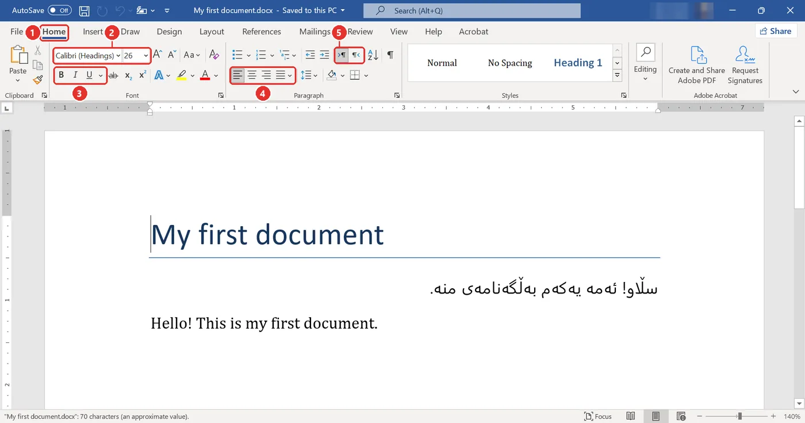

| ژمارە | چییە | چی دەکات |
|---|---|---|
| ((1)) | تابی Home | زۆربەی ئەو دوگمانەی ئەمڕۆ پێویستن لێرەن |
| ((2)) | فۆنت و قەبارە (Size) | جۆری پیت و گەورەیی پیت |
| ((3)) | Bold و Italic و Underline | پیتی ئەستوور (Bold)، لار (Italic)، و هێڵ بەژێردا |
| ((4)) | ڕێکخستنی پەرەگراف | چەپ، ناوەڕاست، ڕاست، و هەردوولا |
| ((5)) | ئاراستەی (Direction) دەق | دێڕی (Line) ئینگلیزی لە چەپەوە، دێڕی کوردی لە ڕاستەوە |

**شریتی خوارەوەی Word** پەڕەکەت و ژمارەی وشەکان پیشان دەدات. ئەگەر دەقێک هەڵبژێریت، بۆ نموونە هەمووی
بە [[Ctrl+A]]، دەڵێت چەند وشەی هەڵبژێردراوە.

## 3. نووسینی کوردی و ئینگلیزی

1. بە [[Win+Space]] زمانی (Language) کیبۆرد هەڵبژێرە، وەک لە وانەی 4.
2. بۆ دێڕی کوردی دوگمەی (Button) **Right-to-Left** ((5)) دابگرە، تا دێڕەکە لە لای ڕاستەوە دەست پێ بکات.
3. بۆ پەرەگرافی نوێ [[Enter]] دابگرە.

> بۆ دەقی کوردی فۆنتێکی وەک **Segoe UI** باشە، چونکە هەموو پیتە کوردییەکانی تێدایە.

## 4. فۆنت، قەبارە و ڕەنگ

سەرەتا دەقەکە **هەڵبژێرە**: دەست لەسەر دوگمەی چەپی ماوس دابنێ و بەسەر دەقەکەدا بیجوڵێنە، یان
[[Ctrl+A]] بۆ هەموو دەقەکە. پاشان:

| کار | دوگمە | کلیل |
|---|---|---|
| فۆنت و قەبارە | ((2)) | — |
| ئەستوور | **B** | [[Ctrl+B]] |
| لار | *I* | [[Ctrl+I]] |
| هێڵ بەژێردا | U | [[Ctrl+U]] |
| ڕەنگی (Colour) پیت | **A** بە هێڵێکی سوورەوە | — |

## 5. پەرەگراف

- **ڕێکخستن** ((4)): چەپ [[Ctrl+L]]، ناوەڕاست [[Ctrl+E]]، ڕاست [[Ctrl+R]]، هەردوولا [[Ctrl+J]].
- **بۆشایی نێوان دێڕەکان:** دوگمەی **Line and Paragraph Spacing** لە تەنیشت دوگمەکانی ڕێکخستنە؛
  1.0 یان 1.5 هەڵبژێرە.

## 6. پاشەکەوتکردن و کردنەوە

1. [[Ctrl+S]] دابگرە.
2. لە جاری یەکەمدا ناوی فایلەکە بنووسە و شوێنەکەی هەڵبژێرە، بۆ نموونە فۆڵدەرەکەی خۆت لە **Documents**.
3. کلیک لە **Save** بکە. لەمەودوا [[Ctrl+S]] بە بێدەنگی پاشەکەوتی دەکات.

بۆ کردنەوەی (Open) فایلێک: لە File Explorer دوو کلیکی (Double-click) لەسەر بکە، یان لە **Word** ← **File** ← **Open**.

## 7. پاشەکەوتکردن وەک PDF

1. **File** ← **Save As** ← **Browse**.
2. لە **Save as type** دا **PDF** هەڵبژێرە.
3. کلیک لە **Save** بکە.

**بۆچی PDF؟** لە هەموو کۆمپیوتەر و مۆبایلێکدا وەک یەک دەردەکەوێت و بە ئاسانی ناگۆڕدرێت، بۆیە بۆ
ناردن (Send) باشترە.

## 8. چاپکردن

[[Ctrl+P]] دابگرە ← چاپکەرەکە هەڵبژێرە ← ژمارەی کۆپییەکان بنووسە ← **Print**. لە لای ڕاست وێنەی (Picture)
پەڕەکان پیشان دەدرێت؛ پێش چاپکردن (Print) سەیری بکە.

## ئەرکی وانەی 5

سی ڤییەکی سادە بۆ خۆت بنووسە: ناو، ژمارەی مۆبایل، ئیمەیلی زانکۆ، خوێندن و تواناکانت. ناوەکەت
گەورە و ئەستوور بێت. لە فۆڵدەرەکەی خۆتدا وەک Word و وەک PDF پاشەکەوتی بکە.

> **کویزی 1:** لە سەرەتای وانەی 6دا، لەسەر ئەم وانەیە: ئۆنلاین، بە ئینگلیزی، لەسەر فایلێکی Word کە دایدەبەزێنیت.

## خۆت بپشکنە — وانەی 5

- [ ] بە کوردی و ئینگلیزی لە Word دەنووسم
- [ ] فۆنت، قەبارە و ڕەنگی دەق دەگۆڕم
- [ ] پەرەگراف ڕێک دەخەم
- [ ] فایلەکەم پاشەکەوت دەکەم و دەیکەمەوە
- [ ] فایلەکەم وەک PDF پاشەکەوت دەکەم
- [ ] دەزانم چۆن چاپی بکەم

# وانەی 6 — بەرنامەی Word، بەشی دووەم

> **ئەمڕۆ فێر دەبیت** ڕاپۆرتێکی تەواو بنووسیت: سەردێڕ (Heading)، ژمارەی پەڕە (Page)، خشتە (Table) و وێنە (Picture)، ڕێکخستنی پەڕە، و
> ڕاپۆرتێکی ڕێکخراو بە بەرگ، سێکشن و لاپەڕەی ناوەڕۆک، پاشان بە جیمەیلی زانکۆ بینێریت.

## 1. سەردێڕەکان

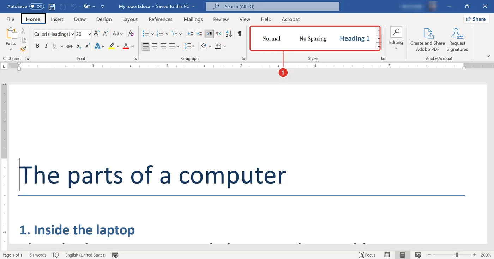

1. کلیک لە دێڕی (Line) سەردێڕەکە بکە.
2. لە **Styles** ((1)) **Heading 1** هەڵبژێرە بۆ سەردێڕی سەرەکی، یان **Heading 2** بۆ سەردێڕی لاوەکی.

**بۆچی Heading و نەک تەنها پیتی گەورە؟** Word سەردێڕەکان دەناسێتەوە: لە **View** ← **Navigation
Pane** لیستیان دەبینیت و بە کلیکێک دەچیتە سەریان.

## 2. خشتە، وێنە و ژمارەی پەڕە

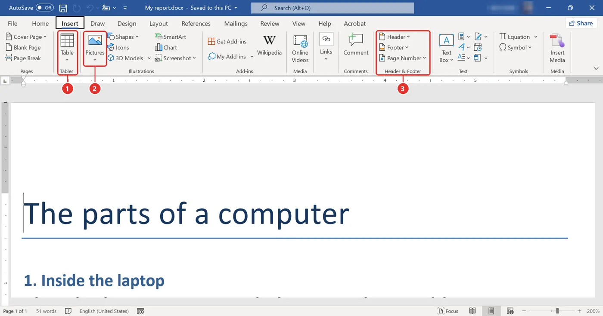

- **خشتە** ((1)): **Insert** ← **Table** ← ماوسەکە بەسەر چوارگۆشەکاندا بجوڵێنە بۆ ژمارەی ستوون (Column) و ڕیز (Row)،
  پاشان کلیک بکە. بۆ چوون بۆ خانەی (Cell) داهاتوو [[Tab]] دابگرە.
- **وێنە** ((2)): **Insert** ← **Pictures** ← **This Device** ← وێنەکە هەڵبژێرە ← **Insert**. بۆ
  گەورە یان بچووککردنی، گۆشەیەکی ڕابکێشە.
- **ژمارەی پەڕە** ((3)): **Insert** ← **Page Number** ← **Bottom of Page** ← شێوەیەک هەڵبژێرە.
  لێرەدا **Header** و **Footer** یش هەن، بۆ نووسینێک لە سەرەوە یان خوارەوەی هەموو پەڕەکان.

## 3. ڕێکخستنی پەڕە

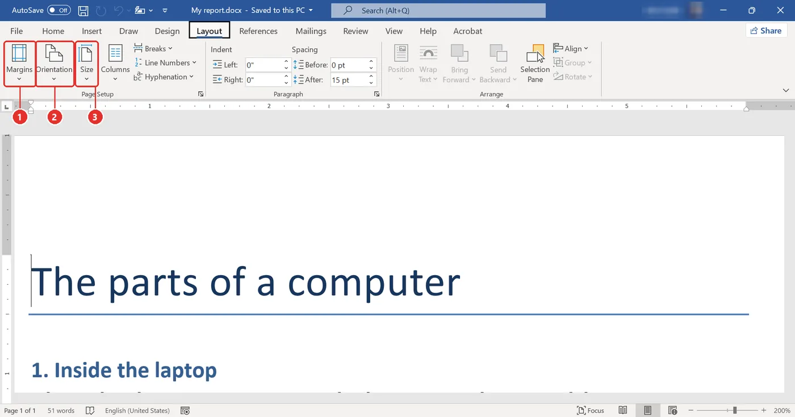

- **Margins** ((1)): لێوارەکان (Margins)؛ بۆ ڕاپۆرت **Normal** باشە.
- **Orientation** ((2)): **Portrait** بۆ پەڕەی درێژ، **Landscape** بۆ پەڕەی پان.
- **Size** ((3)): قەبارەی (Size) پەڕە؛ لە کوردستان **A4** بەکاردێت.

## 4. ڕاپۆرتی ڕێکخراو

ڕاپۆرتێکی باش سێ بەشی هەیە، بەم ڕیزبەندییە. هەر بەشێک سێکشنی خۆی هەیە، بۆ ئەوەی ژمارەی پەڕەکانیان
جیا بن:

| بەش | چی تێدایە | ژمارەی پەڕە |
|---|---|---|
| بەرگ | ناونیشانی (Address) ڕاپۆرت، ناوی خۆت، بەش، ناوی مامۆستا و ساڵ | بێ ژمارە |
| لاپەڕەی ناوەڕۆک | سەردێڕەکان و ژمارەی پەڕەکانیان | بێ ژمارە |
| ناوەڕۆکی ڕاپۆرت | پێشەکی، بەشەکان، کۆتایی و سەرچاوەکان | لە 1 ـەوە |

**قەبارە:** ناوەڕۆکی ڕاپۆرت 4 بۆ 6 لاپەڕە بێت، جگە لە بەرگ و لاپەڕەی ناوەڕۆک، واتە 6 بۆ 8 لاپەڕە بە
گشتی. پەڕەی **A4**، لێواری **Normal**، قەبارەی 12 بۆ دەق (Text)، و بۆشایی دێڕی 1.15 تا 1.5.

### سێکشن

سێکشن بەشێکی ڕاپۆرتەکەیە کە ژمارەی پەڕە، **Header** و **Footer** ی خۆی هەیە.

1. کلیک لە کۆتایی دوایین دێڕی بەرگەکە بکە.
2. **Layout** ← **Breaks** ← لە بەشی **Section Breaks** کلیک لە **Next Page** بکە.
3. پەڕەیەکی نوێ دەست پێ دەکات، کە سێکشنێکی نوێیە. هەمان کار لە کۆتایی لاپەڕەی ناوەڕۆکیش بکە.

> بۆ پەڕەیەکی نوێی ئاسایی، [[Ctrl+Enter]] بەسە. سێکشن تەنها کاتێک پێویستە کە ژمارەی پەڕە یان
> ڕێکخستنی پەڕە دەگۆڕێت. بۆ بینینی سێکشنەکان: **Home** ← دوگمەی (Button) **¶**.

### ژمارەی پەڕەی هەر سێکشنێک

1. دوو کلیک (Double-click) لە خوارەوەی یەکەم پەڕەی ناوەڕۆکی ڕاپۆرت بکە. تابی **Header & Footer** دەکرێتەوە.
2. کلیک لە **Link to Previous** بکە تا بکوژێتەوە. ئێستا ئەم سێکشنە بە سێکشنی پێشووەوە نەبەستراوە.
3. **Page Number** ← **Bottom of Page** ← شێوەیەک هەڵبژێرە.
4. **Page Number** ← **Format Page Numbers** ← لە **Start at** بنووسە 1 ← **OK**.
5. ئەگەر ژمارە لە بەرگ یان لاپەڕەی ناوەڕۆکدا هەبوو، لەوێ بیسڕەوە. ژمارەکانی ناوەڕۆک دەمێننەوە، چونکە
   ئیتر بەستراوە نین.
6. کلیک لە **Close Header and Footer** بکە.

> لە Word ی کۆن ناوی ئەم تابە **Design** ـە، لە ژێر **Header & Footer Tools**.

### لاپەڕەی ناوەڕۆک

1. سەردێڕەکانی ڕاپۆرت بە **Heading 1** و **Heading 2** بن، وەک بەشی 1.
2. کلیک لە سەرەتای لاپەڕەی ناوەڕۆک بکە.
3. **References** ← **Table of Contents** ← **Automatic Table 1**.
4. هەر جارێک ڕاپۆرتەکەت گۆڕی: **References** ← **Update Table** ← **Update entire table** ← **OK**.

بە [[Ctrl]] و کلیک لەسەر سەردێڕێک لە لاپەڕەی ناوەڕۆکدا، دەچیتە سەر ئەو سەردێڕە.

### ناونیشانی وێنە و خشتە

1. کلیک لە وێنەکە یان خشتەکە بکە ← **References** ← **Insert Caption**.
2. لە **Label** دا **Figure** هەڵبژێرە بۆ وێنە، یان **Table** بۆ خشتە. ژمارەکە خۆی دادەنرێت.
3. لە دوای ژمارەکە ناونیشانێک بنووسە ← **OK**.

## 5. ناردنی ڕاپۆرتەکە

1. ڕاپۆرتەکە وەک PDF پاشەکەوت (Save) بکە، وەک لە وانەی 5.
2. لە جیمەیلی زانکۆ ئیمەیلێکی نوێ بنووسە و فایلە PDF ەکەی پێوە بکە، وەک لە وانەی 3.

## ئەرکی وانەی 6

ڕاپۆرتێکی 2 پەڕەیی لەسەر «پارچەکانی کۆمپیوتەر» بنووسە: سەردێڕی Heading 1 و Heading 2، خشتەیەک،
وێنەیەک، و ژمارەی پەڕە. وەک PDF پاشەکەوتی بکە و بە جیمەیلی زانکۆ بۆ مامۆستای بنێرە.

> **کویزی 2:** لە سەرەتای وانەی 7دا، لەسەر ئەم وانەیە: ئۆنلاین، بە ئینگلیزی، لەسەر فایلێکی Word کە دایدەبەزێنیت.

## خۆت بپشکنە — وانەی 6

- [ ] سەردێڕی Heading 1 و Heading 2 دادەنێم
- [ ] خشتە دروست دەکەم و دەینووسم
- [ ] وێنە دادەنێم و قەبارەکەی دەگۆڕم
- [ ] ژمارەی پەڕە دادەنێم
- [ ] لێوار، ئاراستە (Direction) و قەبارەی پەڕە دەگۆڕم
- [ ] ڕاپۆرتەکەم بە جیمەیل دەنێرم
- [ ] بەرگ و لاپەڕەی ناوەڕۆک دروست دەکەم
- [ ] ڕاپۆرتەکە بە سێکشن دابەش دەکەم و ژمارەی پەڕەی ناوەڕۆکەکە لە 1 ـەوە دەست پێ دەکات
- [ ] ناونیشان بۆ وێنە و خشتە دادەنێم

# وانەی 7 — بەرنامەی PowerPoint

> **ئەمڕۆ فێر دەبیت** پێشکەشکردنێک (Presentation) دروست بکەیت: سلاید، دیزاین، دەق (Text) و وێنە (Picture)، ئەنیمەیشنی سادە، و
> پێشکەشکردن لەسەر شاشە (Screen).

## 1. پێشکەشکردنێکی نوێ

**Start** ← **PowerPoint** ← **Blank Presentation**.

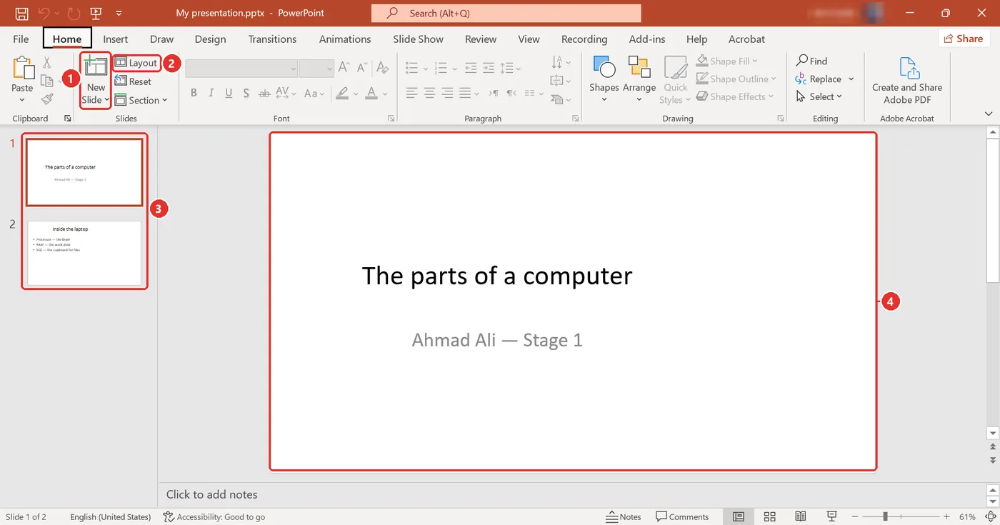

| ژمارە | چییە | چی دەکات |
|---|---|---|
| ((1)) | New Slide | سلایدێکی نوێ زیاد دەکات |
| ((2)) | Layout | شێوەی (Layout) سلاید دەگۆڕێت: سەردێڕ (Heading)، سەردێڕ و دەق، دوو ستوون… |
| ((3)) | سلایدەکان بە بچووکی | کلیک لە یەکێکیان بکە بۆ کارکردن لەسەری |
| ((4)) | سلاید | کلیک لە Click to add title بکە و بنووسە |

## 2. دیزاین

**Design** ← یەکێک لە دیزاینەکان ((1)) هەڵبژێرە. هەموو سلایدەکان دەگۆڕێن.

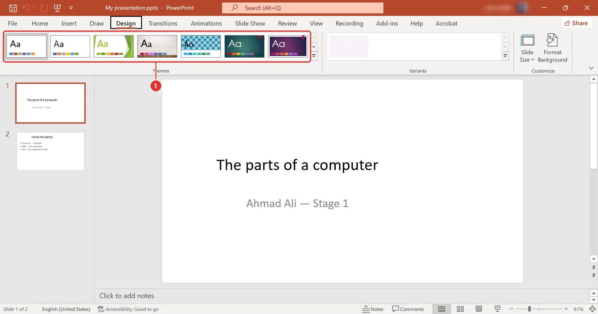

## 3. دەق و وێنە

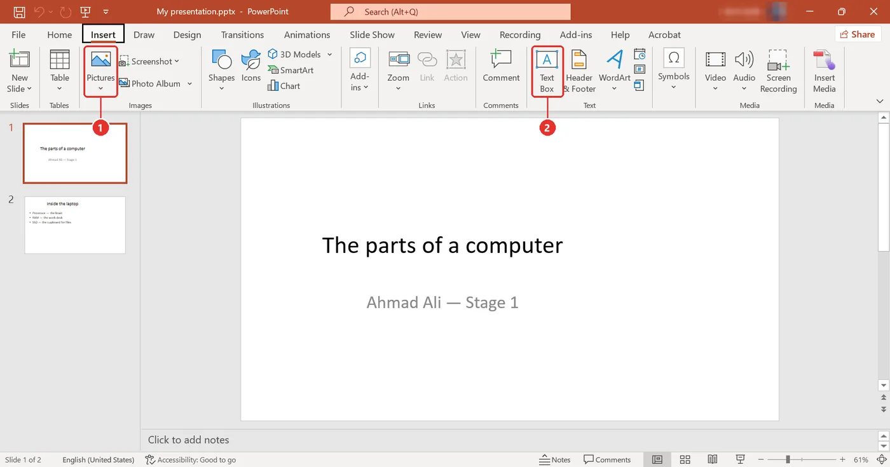

- **وێنە** ((1)): **Insert** ← **Pictures** ← **This Device** ← وێنەکە هەڵبژێرە.
- **Text Box** ((2)): کلیکی لێ بکە، پاشان لەسەر سلایدەکە ڕابکێشە و بنووسە.

> **سلایدی باش:** کەم وشە، پیتی گەورە، وێنەی ڕوون. سلاید بۆ خوێندنەوەی تەواوی دەقەکە نییە.

## 4. ئەنیمەیشنی سادە

1. دەقێک یان وێنەیەک لەسەر سلایدەکە هەڵبژێرە.
2. **Animations** ← ئەنیمەیشنێکی سادە ((1)) هەڵبژێرە، وەک **Fade** یان **Appear**.
3. **Preview** ((2)) دابگرە بۆ بینینی.

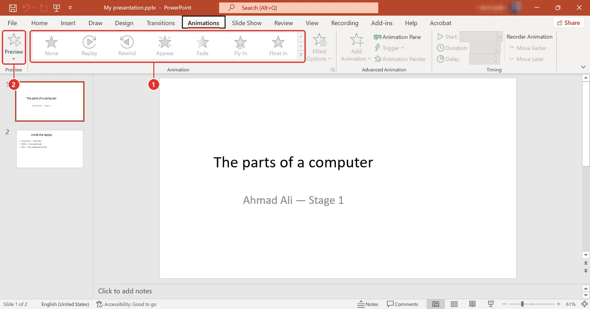

> ئەنیمەیشن زۆر مەکە. یەک ئەنیمەیشنی سادە لە هەموو پێشکەشکردنەکەدا بەسە.

## 5. پێشکەشکردن

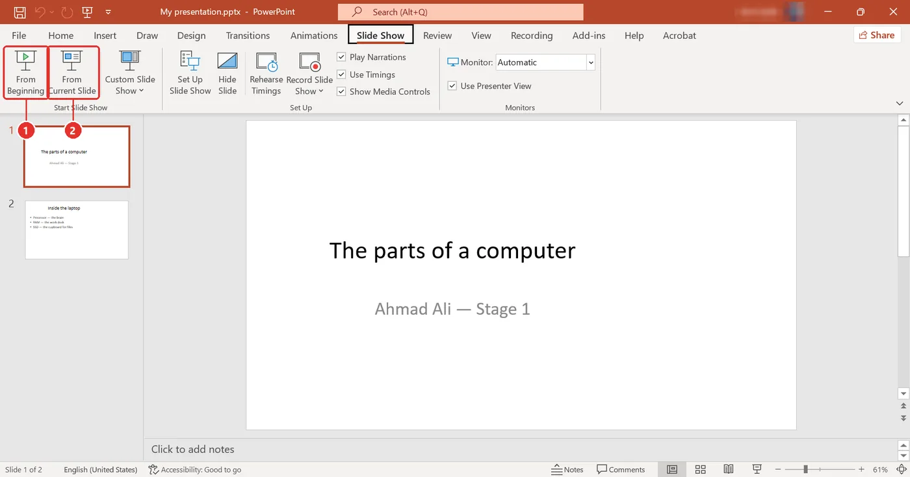

- **From Beginning** ((1)) یان [[F5]]: لە سلایدی یەکەمەوە.
- **From Current Slide** ((2)) یان [[Shift+F5]]: لەو سلایدەی ئێستاوە.
- **سلایدی داهاتوو:** کلیک بکە، یان [[→]] یان [[Space]] دابگرە.
- **کۆتایی:** [[Esc]].

## ئەرکی وانەی 7

پێشکەشکردنێک بە 5 سلاید لەسەر بابەتێک کە خۆت هەڵیدەبژێریت: سلایدێکی سەردێڕ، 3 سلایدی ناوەڕۆک بە
وێنەوە، و سلایدێکی کۆتایی. دیزاینێک و یەک ئەنیمەیشن بەکاربهێنە. لە فۆڵدەرەکەی خۆتدا پاشەکەوتی (Save) بکە.

## ڕاپۆرت — پڕۆژەی کۆتایی

ئەرکی ماڵەوەیە: بابەتێک هەڵبژێرە، ڕاپۆرتێکی لەسەر لە Word بنووسە، پێشکەشکردنێکی لەسەر لە PowerPoint
دروست بکە، و هەردوو فایلەکە بە جیمەیلی زانکۆ بۆ مامۆستا بنێرە. ئەمە نمرەی ڕاپۆرتەکەتە: 16 لە 100.
مامۆستا دواین ڕۆژی ناردنی (Send) پێ دەڵێت. بەرگ، لاپەڕەی ناوەڕۆک و ژمارەی پەڕە وەک بەشی 4 ی وانەی 6
بەکاربهێنە، و ناوەڕۆکی ڕاپۆرتەکە 4 بۆ 6 لاپەڕە بێت، واتە 6 بۆ 8 لاپەڕە بە گشتی.

> **مۆکی فاینەل:** دوای ئەم وانەیە، لە ماڵەوە، 48 کاتژمێر کراوە دەبێت: هەمان جۆری پەڕەی فاینەلە،
> لەسەر فایلێکی Word و فایلێکی PowerPoint. نمرەکەی ناژمێردرێت؛ پیشانت دەدات چی چاوەڕێت دەکات.

> **فاینەل:** لە ڕۆژێکی جیا دوای ئەم وانەیە، 60 خولەک: ئۆنلاین، لەسەر لاپتۆپەکەت، بە ئینگلیزی، لەسەر
> فایلێکی Word و فایلێکی PowerPoint. 40 نمرەیە.

## خۆت بپشکنە — وانەی 7

- [ ] سلایدی نوێ زیاد دەکەم و شێوەکەی دەگۆڕم
- [ ] دیزاینێک هەڵدەبژێرم
- [ ] دەق و وێنە دادەنێم
- [ ] ئەنیمەیشنێکی سادە دادەنێم
- [ ] پێشکەشکردنەکە لە سەرەتاوە پیشان دەدەم و کۆتایی پێ دەهێنم

# پاشکۆ — سەرچاوەی وێنەکان

وێنەی پارچەکانی کۆمپیوتەر لە Wikimedia Commons ـەوە هاتوون. بەکارهێنانیان ئازادە، بە مەرجی
ئەوەی ناوی وێنەگرەکە و مۆڵەتەکەی بنووسرێت. ژمارە سوورەکانی سەر وێنەی پۆرتەکان و کیبۆرد لە
لایەن ئێمەوە زیاد کراون.

- **لاپتۆپ:** [Lenovo ThinkPad T490.jpg](https://commons.wikimedia.org/wiki/File:Lenovo_ThinkPad_T490.jpg) — P2u111 — [CC BY 4.0](https://creativecommons.org/licenses/by/4.0)
- **پرۆسێسەر:** [Mainboard C5V01 LA-E892P - Intel Core i7-8550U-5911.jpg](https://commons.wikimedia.org/wiki/File:Mainboard_C5V01_LA-E892P_-_Intel_Core_i7-8550U-5911.jpg) — Raimond Spekking — [CC BY-SA 4.0](https://creativecommons.org/licenses/by-sa/4.0)
- **ڕام:** [DDR 4 RAM SO-DIMM 8GB by Samsung-top front PNr°0838.jpg](https://commons.wikimedia.org/wiki/File:DDR_4_RAM_SO-DIMM_8GB_by_Samsung-top_front_PNr%C2%B00838.jpg) — D-Kuru — [CC BY-SA 4.0](https://creativecommons.org/licenses/by-sa/4.0)
- **SSD:** [Samsung 980 PRO PCIe 4.0 NVMe SSD 1TB-top PNr°0915.jpg](https://commons.wikimedia.org/wiki/File:Samsung_980_PRO_PCIe_4.0_NVMe_SSD_1TB-top_PNr%C2%B00915.jpg) — D-Kuru — [CC BY-SA 4.0](https://creativecommons.org/licenses/by-sa/4.0)
- **پۆرتەکان:** [Acer Swift 3 rear-left edge.jpg](https://commons.wikimedia.org/wiki/File:Acer_Swift_3_rear-left_edge.jpg) — Bobulous — [CC BY-SA 4.0](https://creativecommons.org/licenses/by-sa/4.0)
- **کیبۆرد:** [Keyboard Lenovo ThinkPad T440p (QWERTY layout).jpg](https://commons.wikimedia.org/wiki/File:Keyboard_Lenovo_ThinkPad_T440p_%28QWERTY_layout%29.jpg) — Kambiel5 — [CC BY-SA 4.0](https://creativecommons.org/licenses/by-sa/4.0)
- **تەچپاد:** [Laptop touchpad 20190320.jpg](https://commons.wikimedia.org/wiki/File:Laptop_touchpad_20190320.jpg) — Santeri Viinamäki — [CC BY-SA 4.0](https://creativecommons.org/licenses/by-sa/4.0)
- **ماوس:** [Generic computer mouse with scrollwheel.jpg](https://commons.wikimedia.org/wiki/File:Generic_computer_mouse_with_scrollwheel.jpg) — Peter Astbury — [CC0](http://creativecommons.org/publicdomain/zero/1.0/deed.en)

وێنەکانی شاشە لەسەر کۆمپیوتەرێکی ویندۆز 11 گیراون و زانیاری کەسییان لەسەر داپۆشراوە.